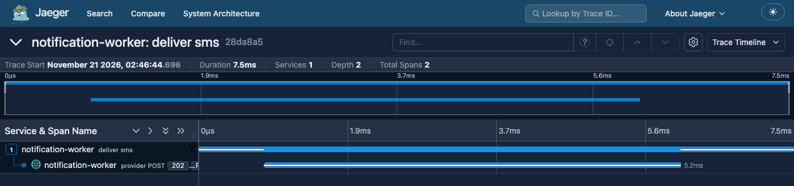

[← Quick start and project overview / Hızlı başlangıç ve proje özeti](../README.md)

This is the full bilingual reference manual. Run every shell command from the repository root, not from `docs/`. / Bu dosya iki dilli ayrıntılı başvuru kılavuzudur. Bütün shell komutlarını `docs/` içinden değil, depo kökünden çalıştırın.

# Event-Driven Notification System

*Türkçe sürüm aşağıda — [Türkçe](#olay-güdümlü-bildirim-sistemi).*

A notification service in Go that queues SMS, email and push notifications in PostgreSQL and delivers them to an external provider under a per-channel rate limit. It is built in slices; see [`docs/PLAN.md`](PLAN.md) for the delivery order and status.

One image holds four programs, each a Compose service: `api` (the HTTP API), `worker` (claims and delivers notifications; several can run), `migrate` (applies the database migrations and exits) and `mockprovider` (a local stand-in for the external provider). There is no message broker: the `notifications` table in PostgreSQL is the queue.

**Current state (core and all six bonuses complete; final release check, slice 16):** `docker compose up` starts PostgreSQL, applies the migrations, and runs the API, a worker and a local mock provider. A created notification is delivered by the worker and reaches `sent`. Temporary failures are retried with backoff up to five attempts, permanent ones stop at once, and a crashed worker's notification is taken back when its lease expires. Each channel is limited to 100 send starts in any one-second window, shared by every worker, and within a channel `high` goes before `normal` before `low`. A `queued` notification can be cancelled, notifications can be listed with filters and a cursor, up to 1,000 notifications can be created in one all-or-nothing batch whose status is counted and paged, and `GET /metrics` reports queue depth, completions and latency per channel. While the provider keeps failing, one circuit breaker shared by every worker pauses claims on all channels and lets a single probe test the provider before they resume. A notification can carry an absolute `scheduled_at` and is not sent before it. A WebSocket client can follow one notification or one batch: it gets the current state, then each status change. Stored templates with `{{name}}` placeholders are rendered once at the API, and the worker sends the rendered content. With an OTLP endpoint set, the API request, each delivery attempt and each provider call produce OpenTelemetry spans, which Jaeger shows.

## Requirements

- Docker with Compose v2, running (Docker Desktop or any other runtime).
- For running the tests and tools on the host: Go 1.27.4 and golangci-lint v2.15.0.
- For the example commands: `curl` and `jq`.

## Quick start

```bash
docker compose up
```

`docker-compose up` works the same. The services start in this order: `postgres` becomes healthy, `migrate` applies the migrations and exits with 0, then `api` and `worker` start; `mockprovider` starts before the worker. To start in the background and wait until the API is healthy:

```bash
docker compose up -d --build
scripts/wait-health.sh api healthy 60
```

Then:

```bash
curl -s http://localhost:8080/healthz
curl -s http://localhost:8080/readyz
```

| URL | What it is |
|---|---|
| `http://localhost:8080/healthz` | Liveness: `200` whenever the process can answer; checks no dependency |
| `http://localhost:8080/readyz` | Readiness: pings PostgreSQL; `200` with each check's result, `503` naming the failing check, `503` during shutdown |
| `http://localhost:8080/openapi.yaml` | The OpenAPI 3.1 document (also `/openapi.json`) |
| `http://localhost:8080/docs` | Interactive API docs (loads its viewer from a CDN) |
| `http://localhost:8081/stats` | The mock provider's arrival counts per channel ([Mock provider](#mock-provider)) |

Stop with `docker compose down`; `docker compose down -v` also deletes the database volume, and the next start rebuilds the schema from the migrations.

## How it works

```
client ──POST /notifications──► api ──INSERT──► notifications table ◄──claim, result── worker ──POST──► provider
                                 202 at once     (PostgreSQL, the queue)
```

- The API validates the request, saves the notification as `queued` (or, for a batch, all of up to 1,000 notifications in one transaction) and answers `202`. It never calls the provider, so its response time does not depend on the provider.
- The `notifications` table is the queue. A worker claims on one channel at a time: in one statement it takes the channel's permit from its row in `channel_limits` and the channel's next due `queued` notification (`high → normal → low`, then the earliest `available_at`), both with `SKIP LOCKED`, and puts the notification under a lease: `processing`, a new `lease_token`, `lease_expires_at` 30 seconds ahead and `attempts + 1` ([Rate limit and priority](#rate-limit-and-priority)). Several workers can run against the same table (`docker compose up --scale worker=2`); they share each channel's permits, and a notification has one valid lease at a time.
- The worker posts `{to, channel, content}` to `PROVIDER_URL` with the notification's `X-Correlation-ID`, a 5-second timeout and no redirects. The send starts only before the permit's start deadline, and the call ends at least `RESULT_BUDGET` before the lease does.
- The result is written only while the row is still `processing` under the same token and the lease has not expired by the database clock. A `202` ends as `sent`, with `sent_at` recording the acceptance and `provider_message_id` and `provider_timestamp` taken from usable response fields. An unusable optional field (including a NUL in `messageId`) is left empty with a warning, while a readable timestamp is retained. A `202` whose body is broken, or never finishes arriving, still ends as `sent`, with the provider metadata empty and a warning in the log: the provider accepted the notification, and a second POST could deliver it twice.
- A temporary failure goes back to `queued` with a later `available_at`; a permanent one ends as `failed` ([Retries and failures](#retries-and-failures)).
- Every worker also takes back leases that expired because their worker crashed or stalled.
- While the provider is failing, one circuit breaker shared by every worker stops new claims on all channels, so waiting notifications keep their attempts ([Provider outage](#provider-outage)).
- On `SIGTERM` the worker stops claiming at once, lets the calls in flight finish and write their results, and exits within 10 seconds.

### Claim, lease and permit

**Claim.** A worker takes work with one SQL statement per channel. It locks the channel's row in `channel_limits` and the channel's next due `queued` notification, both with `SKIP LOCKED`, so two workers never wait for each other and never take the same row. The notification order is `high`, `normal`, `low`, then the earliest `available_at`, then the lowest ID. The claim counts the attempt at once (`attempts + 1`), so a worker that crashes mid-send still used one of the five attempts.

**Lease.** The claimed row becomes `processing` with a new `lease_token` and a `lease_expires_at` 30 seconds ahead by the database clock. Every result write (`sent`, `failed`, back to `queued`) needs the same token and an unexpired lease, so a worker that stalled past its lease can no longer change the row. Every worker regularly takes back expired leases: the row goes back to `queued`, or to `failed` after its last attempt. A notification therefore has one valid lease at a time, but the provider may receive it twice when an outcome was unclear ([Known limits](#known-limits)).

**Permit.** The same statement takes the channel's permit: it claims only when `next_permit_at` has come and then moves it 11 ms ahead. The send must start within 100 ms of its permit or it is not sent and the notification goes back to `queued`. Together these bound every channel to 100 send starts in any one-second window across all workers ([Rate limit and priority](#rate-limit-and-priority)).

### Follow a notification to `sent`

```bash
ID=$(curl -s -X POST http://localhost:8080/notifications \
  -H 'Content-Type: application/json' -H 'X-Correlation-ID: demo-1' \
  -d '{"recipient":"+905551234567","channel":"sms","content":"hello"}' | jq -r .id)
sleep 2   # the worker sends it within a second or two
curl -s "http://localhost:8080/notifications/$ID" | jq '{status, attempts, provider_message_id, sent_at}'
docker compose logs --no-log-prefix worker | grep '"correlation_id":"demo-1"'
```

The worker writes two JSON lines per attempt: `provider call started` with `started_at`, the send start the start gate read right before handing the request to the HTTP transport, and `provider call finished` after the call with `status_code`, `duration_ms`, `class` and `outcome` (`sent`, `queued` for a retry, or `failed`). Both carry `worker_id`, `correlation_id`, `notification_id`, `channel` and `attempt`. A claim whose start deadline passed before the send writes one `start deadline missed …` line instead and no start line. Recipients and content are never logged.

## Retries and failures

Each attempt's result is classified, and the notification's next state follows from the class:

| Provider answer | Class | What happens |
|---|---|---|
| `202` | accepted | `sent`, on any attempt, the fifth included |
| Network error, timeout, `408`, `500`, `502`, `503`, `504` | temporary | Back to `queued` with a later `available_at`; `failed` after the fifth attempt |
| `429` | temporary under `standard`; permanent under `webhook_site_free` | A free webhook.site URL answers `429` only when its request quota is used up, and waiting does not reopen it, so that profile stops at once |
| `400`, `501` | permanent | `failed` on this attempt, whatever attempts are left |
| Any other code: another `2xx`, a `3xx` (redirects are never followed), another `4xx` or `5xx` | terminal | `failed` on this attempt and never retried: an unexpected `2xx` may mean the provider processed the request |

- **Backoff:** the n-th retry waits a random time between 0 and min(60 s, 2 s × 2^(n−1)) (full jitter). A valid `Retry-After`, in seconds or as an HTTP date, that asks for longer wins, even beyond 60 s. The wait is written to `available_at` in PostgreSQL, so a waiting retry holds no worker and survives a restart.
- **`last_error`** reads `<class>: <detail>`, for example `temporary: status 503`, `permanent: status 400` or `terminal: unexpected status 200`.
- **Attempts** are counted when a worker claims the notification, so an attempt counts even if the worker crashes right after its POST. At most five attempts are made.
- **Crash recovery:** every `RECOVERY_INTERVAL` (5 s) each worker takes back at most `RECOVERY_BATCH` (100) notifications whose lease has expired by the database clock: back to `queued`, or `failed` if that was the fifth attempt, with `last_error` `temporary: lease expired before a result was written`. Workers recovering at the same time never take the same row. With a 30-second lease, a crashed worker's notification is expected back within about 35 seconds while any worker runs; nothing is recovered while no worker runs. A worker whose lease has ended can never change the row, and it does not start a POST it could not finish within its lease.
- **What `failed` means:** the attempts ran out or the error was permanent. It does not prove the notification was never delivered: an earlier attempt may have timed out after the provider had already accepted it.
- **Duplicates are possible:** this is not exactly-once delivery. When the outcome of an attempt is unclear, a retry can become a second send: for example, the provider accepts the request but its answer is lost or arrives after the timeout, or the worker receives `202` and crashes before writing it. webhook.site documents no deduplication. Repeated **API requests** never create a second notification when they carry the same `Idempotency-Key`.

## Provider outage

All three channels post to the one `PROVIDER_URL`, so one circuit breaker guards the provider. Every worker shares it through a single PostgreSQL row, `provider_breaker` ([K34](DECISIONS.md#k34--failure-handling-b1-one-circuit-breaker-for-the-provider-shared-by-all-workers)).

- **Opening.** Outage failures count: a network error, a timeout, `408`, `500`, `502`, `503` and `504`. After `BREAKER_THRESHOLD` (5) in a row, the breaker opens for `BREAKER_COOLDOWN` (30 s). A `429` and permanent or terminal errors do not count, because they concern the request, not the provider. A success clears the count.
- **While open.** No worker claims on any channel, so waiting notifications stay `queued` and their attempts do not move. Calls that had already started finish and write their result: a late `202` still marks its notification `sent`, but no result from before the opening moves the breaker.
- **One probe.** When the cooldown ends, exactly one claim across all workers becomes the probe.
  - A `202` closes the breaker, and the queue moves on.
  - An outage failure reopens it with the cooldown doubled, up to `BREAKER_MAX_COOLDOWN` (5 min).
  - Any other answer (`400`, a terminal code, a `429`) or a missed start deadline only frees the probe slot, and the next claim becomes the probe.
  - A probe whose worker crashed holds the slot until its lease ends. A probe that answers after its lease ended moves nothing.
- **`429` and `Retry-After`.** A `Retry-After` delays only its own notification. Neither profile states that the provider's quota covers the whole URL, so a `429` never opens the breaker.
- **Logs.** The result write that moves the breaker writes `breaker opened` or `breaker reopened` (`warn`, with `generation`, `cooldown` and `open_for`) or `breaker closed` (`info`, with `generation` and `cooldown`). The probe's own lines carry `"breaker_probe":true`.

A failure that hits only one channel at the provider still pauses all three ([Known limits](#known-limits)). The [slice 11 stack check](slices/11-circuit-breaker.md#stack-check) shows the breaker on the running stack: it points the worker at a closed port, then back at the mock.

## Rate limit and priority

**The limit.** Each channel gets at most 100 **send starts** in any one-second window `[t, t + 1 s)`, however many workers run. A send start is the moment the worker hands the request to the HTTP transport, recorded as `started_at` in its start line; the mock provider's arrival times are reported separately and are not the measure.

- **One permit row per channel.** `channel_limits` holds `next_permit_at` for `sms`, `email` and `push`, shared by every worker. A claim locks its channel's row with `SKIP LOCKED` (another worker holding it: the claim returns at once), reads the database clock once, and takes the permit only when `next_permit_at` has come; it then claims one notification and moves `next_permit_at` to `PERMIT_INTERVAL` (11 ms) after the permit, all in one statement. A channel with no due notification keeps its permit, and a notification waiting for a permit stays `queued`.
- **A start deadline.** A permit is valid for `PERMIT_GRACE` (100 ms). The provider client's start gate reads the clock, compares it with that deadline and, before it, records that reading as the send start, in one step at the last point before the transport. A request past its deadline is not sent: the notification goes back to `queued` with its attempt returned, once and only under its own lease, and the permit is not given back.
- **Why it holds:** 101 starts need 101 permits, the first and the last at least 100 × 11 ms = 1,100 ms apart. A start comes at most 100 ms after its permit, so the first and the last start are at least 1,000 ms apart and cannot share a window. This holds when a worker pauses, for example after its claim. `Validate()` refuses settings for which 100 × `PERMIT_INTERVAL` − `PERMIT_GRACE` is below one second.
- **What it costs:** permits are used up to about 91 per second per channel. Measured, a full channel reached 82 to 89 starts in its busiest second: each claim's round trip to PostgreSQL comes on top of the 11 ms.
- **Claim loop:** each worker keeps a next try per channel: at once after a claim, after the remaining wait (at most `PERMIT_INTERVAL`) when the permit is not due yet, after `PERMIT_INTERVAL` when another worker holds the row, and after `IDLE_WAIT` when the channel has nothing due. It always tries the channel whose turn comes first, so an empty or busy channel never slows the others. Retries take permits like first attempts.

**Priority.** Within a channel, a worker takes `high` before `normal` before `low`, then the earliest `available_at`, then the lowest ID. The order comes from the PostgreSQL enum's declared order and is served by a partial index on queued rows. Channels do not compete: each has its own limit. The order is the order of claims; calls run in parallel, so they can reach the provider in another order. **Cost:** `low` waits as long as higher-priority work fills the channel, without limit.

**Calls in flight.** To use the full limit, the calls in flight across all workers must cover the provider's latency: about 3 channels × 91 per second × latency. With a provider answering in 200 ms and two workers, the load test below sent everything within 30 seconds at 10 calls per worker only partly, reached 69 to 70 starts per channel in the busiest second at 20, 89 at 30 and 85 at 40. `IN_FLIGHT` defaults to 30 per worker; a single worker against a 200 ms provider would need about 60. Against the mock, which answers at once, a few calls are enough.

**Measuring it.** The tests count starts with the same code as `cmd/ratecount`:

```bash
go test -count=1 -v -run '^(TestSendStartsWithPausedWorker|TestRateLimitTwoWorkers)$' ./internal/worker/
R8_IN_FLIGHT=30 R8_PROVIDER_DELAY=200ms go test -count=1 -v -run '^TestRateLimitTwoWorkers$' ./internal/worker/
```

On the stack, in its own Compose project with two workers (free the host ports first with `docker compose stop`, and run `docker compose start` afterwards):

```bash
P="nsys-r8-$(date +%s)"
PROVIDER_URL=http://mockprovider:8081/ PROVIDER_PROFILE=standard MOCK_DELAY=0s \
  docker compose -p "$P" up -d --build --scale worker=2
scripts/wait-health.sh -p "$P" api healthy 60
go run ./cmd/loadgen -url http://127.0.0.1:8080 -per-channel 1000; echo "loadgen exit=$?"
# wait until nothing is queued or processing, then:
docker compose -p "$P" logs --no-log-prefix worker | go run ./cmd/ratecount; echo "ratecount exit=$?"
curl -s http://localhost:8081/stats | jq .
docker compose -p "$P" down -v
```

A run on 2026-11-20: 3,000 creates accepted in 630 ms; all `sent` 16 seconds after the first create; `ratecount` printed `max_window` 83 (`email`), 83 (`push`) and 84 (`sms`) with `starts=1000` each and `workers=2`; no start deadline was missed; the mock's arrival maxima were the same. One passing run is a measurement, not a guarantee: the bound comes from the permit spacing and the start deadline.

## API

### Create a notification

```bash
RESP=$(curl -s -X POST http://localhost:8080/notifications \
  -H 'Content-Type: application/json' \
  -H 'Idempotency-Key: order-1234-sms' \
  -d '{"recipient":"+905551234567","channel":"sms","content":"Your code is 123456","priority":"high"}')
echo "$RESP"; ID=$(echo "$RESP" | jq -r .id)
```

```json
{"id":"01a1f8ad-6307-7877-9585-950a91640e40","status":"queued"}
```

The API answers `202 Accepted` as soon as the notification is saved; delivery happens later in a worker. `priority` is optional (`high`, `normal` or `low`; default `normal`). Every response carries an `X-Correlation-ID` header: the client's value if it is at most 64 characters from `A–Z a–z 0–9 - _ .`, otherwise a generated one. The ID is stored on the notification.

### Read a notification

```bash
curl -s "http://localhost:8080/notifications/$ID"
```

`ID` is the one the create above printed. Returns `id`, `recipient`, `channel`, `content`, `priority`, `status`, `attempts`, `last_error`, `batch_id` (`null` for a single create), `provider_message_id`, `provider_timestamp`, `sent_at`, `created_at` and `updated_at`. An unknown ID gets `404`, a malformed one `422`. `sent_at` records when the provider's acceptance was saved. `provider_message_id` and `provider_timestamp` come from usable fields of the `202` body; a missing or invalid field stays `null`, independently of the other field. `provider_message_id` is not unique: a provider with a static response, such as a free webhook.site URL, gives every notification the same ID.

### List notifications

```bash
curl -s 'http://localhost:8080/notifications?channel=sms&status=sent&from=2026-11-20T00:00:00Z&limit=20'
```

Returns `{"items": [...], "next_cursor": "..."}`, newest first (`created_at`, then ID, both descending). Each item has the same fields as a single read.

| Parameter | Rule |
|---|---|
| `status` | `queued`, `processing`, `sent`, `failed` or `cancelled` |
| `channel` | `sms`, `email` or `push` |
| `from`, `to` | RFC 3339 times on `created_at`; `from` is included, `to` is not |
| `limit` | Page size, 50 by default, 1 to 200; `0` or `201` gets `422` |
| `cursor` | The `next_cursor` of the previous page, unchanged |

Filters combine with AND. To read every page, pass each `next_cursor` back until it is absent:

```bash
CURSOR=$(curl -s 'http://localhost:8080/notifications?channel=sms&limit=50' | jq -r '.next_cursor // empty')
curl -s -G http://localhost:8080/notifications --data-urlencode channel=sms --data-urlencode limit=50 \
  --data-urlencode "cursor=$CURSOR"
```

The cursor holds the last row's `created_at` and ID, so notifications created meanwhile do not shift the pages: every notification that existed when the first page was read appears exactly once. Each page is a separate query, though, not one snapshot: a notification whose status changes between pages can move into or out of a filtered list. A cursor that did not come from a previous page gets `400`. There is no total count and no jumping to a page.

### Cancel a notification

```bash
curl -s -X POST "http://localhost:8080/notifications/$ID/cancel"
```

Only a **pending** notification can be cancelled, and pending means `queued`: waiting for its first attempt, for its channel's rate limit or for its retry time. No worker holds it then, so stopping it is safe.

| Status when the cancel arrives | Answer |
|---|---|
| `queued` | `200` with the notification, now `cancelled` |
| `cancelled` | `200` with the notification, unchanged |
| `processing`, `sent` or `failed` | `409`: a worker holds the notification or it has ended, and its POST may already be on its way |
| Unknown ID | `404`; a malformed ID gets `422` |

The `409` is an RFC 9457 problem whose `current_status` names the notification's status:

```json
{"title":"Conflict","status":409,"detail":"the notification is sent; only a queued notification can be cancelled","current_status":"sent"}
```

The cancel locks the row and decides from the status it reads under the lock. A cancel and a worker's claim racing for the same notification always end with one winner: either the notification is `cancelled` and no POST goes out for it, or the worker holds it and the cancel gets `409`. A notification waiting for a retry is `queued`, so it can be cancelled then, and no further POST follows. There is no batch cancel.

### Batches

```bash
RESP=$(curl -s -X POST http://localhost:8080/notifications/batch \
  -H 'Content-Type: application/json' \
  -H 'Idempotency-Key: campaign-42' \
  -d '{"notifications":[
        {"recipient":"+905551234567","channel":"sms","content":"one","priority":"high"},
        {"recipient":"a@example.com","channel":"email","content":"two"},
        {"recipient":"device-token-1","channel":"push","content":"three","priority":"low"}]}')
echo "$RESP"; BATCH_ID=$(echo "$RESP" | jq -r .batch_id)
```

```json
{"batch_id":"01a1f9f2-5de8-77ce-bd30-03a9e9616567","notification_ids":["…","…","…"]}
```

A batch holds 1 to 1,000 notifications, each with its own channel and priority, and is saved **all or nothing**: every item is checked with the same rules as a single create, every error is collected, and if any item is invalid the answer is `422` with each error's item in its location (`body.notifications[5].channel`) and nothing is saved. Otherwise one transaction writes the batch, all its notifications and the idempotency key. `notification_ids[i]` belongs to `notifications[i]`. Every item stores the request's `X-Correlation-ID`.

There are two separate limits: the item count (1 to 1,000; `0` or `1001` gets `422`) and the request body size: 16 MiB by default, set with `BATCH_MAX_BODY_BYTES`, answered with `413`. The body limit is not derived from the content limits, because escaped JSON can take 12 bytes for one emoji (`\ud83d\ude00`). So a batch of large items can get `413` with fewer than 1,000 items; split it into smaller batches.

```bash
curl -s "http://localhost:8080/batches/$BATCH_ID?limit=50"
```

```json
{"id":"01a1f9f2-…","item_count":3,"created_at":"…","counts":{"queued":0,"processing":0,"sent":3,"failed":0,"cancelled":0},"items":[…]}
```

`counts` lists all five statuses, zeros included. `items` are the batch's own notifications in the listing order, paged with `limit` (50 by default, 1 to 200) and `next_cursor` exactly as in [List notifications](#list-notifications). The counts and the page are read in one snapshot, so they agree with each other; the next page is a new read. An unknown batch gets `404`.

### Scheduled notifications

```bash
AT=$(date -u -v+10S +%Y-%m-%dT%H:%M:%SZ 2>/dev/null || date -u -d '+10 seconds' +%Y-%m-%dT%H:%M:%SZ)
RESP=$(curl -s -X POST http://localhost:8080/notifications -H 'Content-Type: application/json' \
  -d "{\"recipient\":\"+905551234567\",\"channel\":\"sms\",\"content\":\"later\",\"scheduled_at\":\"$AT\"}")
echo "$RESP"; ID=$(echo "$RESP" | jq -r .id)
curl -s "http://localhost:8080/notifications/$ID" | jq '{status, scheduled_at}'   # queued until then
```

`scheduled_at` is optional on `POST /notifications` and on every batch item ([K26](DECISIONS.md#k26--scheduled-notifications-b2-an-optional-absolute-scheduled_at)). It is an absolute time in RFC 3339 **with an offset**, `Z` or `±hh:mm`; a time without an offset gets `422`, because it would mean a different moment on every server. The time is stored in UTC, and the notification is not claimed before it: it waits in `queued` and counts as `deferred` in the metrics.

- **Past times.** A new request whose time is at or before the database clock gets `422` naming `body.scheduled_at` (in a batch `body.notifications[i].scheduled_at`), and nothing is saved. A client whose clock runs ahead or behind should leave a margin. There is no upper limit.
- **Repeats.** `scheduled_at` is part of the idempotency request hash, normalized to UTC: the same key with another time gets `422`, while the same instant written with another offset is the same request. The past-time rule runs only for a new key, so a repeat after the time has passed still returns the first `202`.
- **Everything else as usual.** A scheduled notification can be cancelled while it is `queued`; once due it follows priority and the rate limit like any other notification, and retries move only `available_at`, never `scheduled_at`. Within a batch, items of the same channel and priority go out in `scheduled_at` order; other channels and priorities follow the rate limit and priority first.
- **Latency.** `GET /metrics` measures scheduled notifications from `scheduled_at` (`scheduled_latency`), not from `created_at`, so a planned wait never shows as delivery latency.

### Templates

```bash
TPL=$(curl -s -X POST http://localhost:8080/templates -H 'Content-Type: application/json' \
  -d '{"name":"welcome","channel":"sms","body":"Hello {{first_name}}, your code is {{code}}"}' | jq -r .id)
curl -s -X POST http://localhost:8080/notifications -H 'Content-Type: application/json' \
  -d "{\"recipient\":\"+905551234567\",\"channel\":\"sms\",\"template_id\":\"$TPL\",\"variables\":{\"first_name\":\"Deniz\",\"code\":\"4821\"}}"
curl -s "http://localhost:8080/templates?limit=10" | jq '.items[] | {id, name, created_at}'
```

A template is stored once and used by any number of notifications ([K33](DECISIONS.md#k33--templates-b3-immutable-stored-templates-with-name-placeholders-rendered-at-the-api), [K47](DECISIONS.md#k47--template-details-a-paged-list-422-for-an-unknown-template-in-a-body)).

| Endpoint | Answer |
|---|---|
| `POST /templates` | `201` with `{id, name, channel, body, created_at}`; `400` for malformed JSON, `422` for any rule below |
| `GET /templates/{id}` | `200`; `404` for an unknown ID, `422` for a malformed one |
| `GET /templates` | Newest first, paged with `limit` (default 50, 1 to 200) and `next_cursor`, as `GET /notifications` |

- **Rules.** `name`: 1 to 100 code points, not unique (`created_at` tells templates with the same name apart). `body`: 1 to 10,000 code points. Neither may contain NUL. `channel`: `sms`, `email` or `push`.
- **Syntax.** `{{name}}` is a placeholder; a name matches `[A-Za-z_][A-Za-z0-9_]*`, with no spaces inside the braces. Single braces are plain text. An unclosed `{{`, an empty `{{}}`, `{{1st}}` or `{{ name }}` gets `422` when the template is created.
- **Templates never change.** There is no update or delete (`PUT`, `PATCH` and `DELETE` get `405`); a changed message is a new template.
- **Using one.** A create request, single or batch item, carries either `content` or `template_id` with `variables`: both or neither get `422`. The template's channel must equal the request's, `variables` must hold exactly one string per placeholder, and an unknown `template_id` gets `422` on that field.
- **Rendering.** The API renders the content once, when it saves a new notification: each placeholder is replaced by its value as given, so a `{{x}}` inside a value stays as it is. The result follows the same rules as `content`: it may not be empty or contain NUL, and rendering stops with `422` as soon as it passes the channel's limit. The notification stores the rendered `content` and the `template_id`, not the variables; the worker sends that content on every attempt.
- **Idempotency.** The request hash covers `template_id` and the variables, so the same key with other variables gets `422`, and a repeat returns the first `202` without rendering again. In a batch, one item that fails rejects the whole batch with that item's index.

### Real-time status

```bash
go run ./cmd/wswatch -url "ws://localhost:8080/ws/notifications/$ID" -for 30s   # or /ws/batches/$BATCH_ID
```

Two WebSocket endpoints follow one notification or one batch ([K24](DECISIONS.md#k24--real-time-status-events-b4-postgresql-listennotify), [K25](DECISIONS.md#k25--websocket-endpoint-b4-coderwebsocket-one-notification-or-batch-per-connection)). They are not in the OpenAPI document, which does not describe WebSockets.

| Endpoint | First message | Then |
|---|---|---|
| `GET /ws/notifications/{id}` | The notification's current state, `type` `snapshot` | One `update` per status change |
| `GET /ws/batches/{id}` | Every notification of the batch, `type` `snapshot` | One `update` per status change of any item |

Only the server sends. A run of `cmd/wswatch` on a notification scheduled 15 seconds ahead printed:

```json
{"type":"snapshot","notification_id":"01a1fb38-2482-7c67-9b60-8a3522747d9b","batch_id":null,"status":"queued","attempts":0,"version":0,"updated_at":"2026-11-20T23:08:43.004539Z"}
{"type":"update","notification_id":"01a1fb38-2482-7c67-9b60-8a3522747d9b","batch_id":null,"status":"processing","attempts":1,"version":1,"updated_at":"2026-11-20T23:08:57.079818Z"}
{"type":"update","notification_id":"01a1fb38-2482-7c67-9b60-8a3522747d9b","batch_id":null,"status":"sent","attempts":1,"version":2,"updated_at":"2026-11-20T23:08:57.094705Z"}
```

A batch snapshot is `{"type":"snapshot","batch_id":"…","notifications":[…]}`, with the same six fields per item. `version` counts one notification's status changes; compare it only within the same `notification_id`.

- **How events are made.** A database trigger publishes every status change with `pg_notify` when its transaction commits: the claim, a result, a retry, a cancel and lease recovery. The API keeps one connection that runs `LISTEN` and passes each event to the subscribers of that notification or batch.
- **No gap after the snapshot.** A subscriber is registered first and its events are queued; then the snapshot is read and sent; then only events with a higher `version` for the same notification are sent.
- **Best effort.** A snapshot, then updates for as long as the connection lasts. Nothing is replayed: when the connection closes, reconnect for a fresh snapshot, or read the state with `GET`. The server closes a connection with `1013` (try again later) when its listener connection drops, `1008` when the client reads too slowly and its queue of `WS_SEND_QUEUE` messages fills, and `1001` when the API shuts down. While the listener is reconnecting, a new request gets `503` with `Retry-After: 1` and no upgrade.
- **Message size.** The largest message is the snapshot of a 1,000-item batch, about 195 KB (measured by `TestBatchSnapshotMaxSize`). Many WebSocket clients read at most 32 KiB per message by default, `coder/websocket` among them; set the read limit to at least 256 KiB. `cmd/wswatch` uses 1 MiB.
- **UUID case.** Hyphenated UUIDs are accepted in uppercase, lowercase or mixed case and normalized to lowercase for the subscription and snapshot lookup.
- **Unknown IDs** get `404` before the upgrade. Browsers are accepted only from the same origin.

### Metrics

```bash
curl -s http://localhost:8080/metrics | jq '{as_of, sms: .channels.sms}'
```

```json
{"as_of":"2026-11-20T17:23:07.414075Z","sms":{"queue":{"high":{"ready":0,"deferred":0,"oldest_ready_age_seconds":null},"normal":{…},"low":{…}},
 "processing":0,
 "completed":{"window_seconds":60,"sent":5,"failed":0,"sent_per_second":0.0833,"failed_per_second":0,"success_ratio":1},
 "latency":{"samples":5,"p50_ms":193.341,"p95_ms":197.05,"p99_ms":197.569},
 "scheduled_latency":{"samples":0,"p50_ms":null,"p95_ms":null,"p99_ms":null}}}
```

Every value is read in one database snapshot, taken at `as_of` (the database clock, RFC 3339 with microseconds), so the numbers of one response agree with each other. `channels` always holds `sms`, `email` and `push`, and `queue` always holds `high`, `normal` and `low`.

| Field | What it counts |
|---|---|
| `queue.<priority>.ready` | `queued` notifications whose `available_at` is at or before `as_of` |
| `queue.<priority>.deferred` | `queued` notifications waiting for a later `available_at`: a retry or a scheduled notification |
| `queue.<priority>.oldest_ready_age_seconds` | `as_of` minus the earliest `available_at` of the ready ones; `null` when none is ready. A growing age for `low` while `high` keeps arriving shows starvation |
| `processing` | Notifications a worker holds at `as_of`; high while nothing completes means a stalled worker |
| `completed.sent`, `completed.failed` | Notifications that became `sent` or `failed` with `completed_at` after `as_of − 60 s` and at or before `as_of` |
| `completed.sent_per_second`, `completed.failed_per_second` | The counts divided by 60; `0` when nothing completed |
| `completed.success_ratio` | `sent / (sent + failed)`; `null` when nothing completed |
| `latency.samples`, `latency.p50_ms`, `p95_ms`, `p99_ms` | `created_at → sent_at` of the notifications sent in the window without `scheduled_at`, with `percentile_cont`; `null` without samples |
| `scheduled_latency.samples`, `p50_ms`, `p95_ms`, `p99_ms` | `scheduled_at → sent_at` of the scheduled notifications sent in the window; `null` without samples |

Cancellations and retries that are still waiting are not completions. `sent` means the provider accepted the request. The latency includes queue waiting and retries; in the Compose stack it also includes the worker's idle wait (`IDLE_WAIT`, 200 ms) before it claims a new notification. The endpoint summarizes completed notifications: it is not the proof of the rate limit, which counts the actual send starts ([Rate limit and priority](#rate-limit-and-priority)). With 100,000 notifications the whole call took about 11 ms; the `processing` count is a sequential scan (about 5 ms), the queue counts read the claim index and the completions the `completed_at` index.

### Idempotency

`Idempotency-Key` is optional. When present it must be sent once and hold 1 to 128 characters from `A–Z a–z 0–9 . _ -`; otherwise the request gets `400` and nothing is saved.

- The same key with the same request returns the **first** `202` response, byte for byte, and creates nothing new. `GET` shows the current state.
- The same key with a different request gets `422`.
- Two requests without a key are two notifications.
- One key covers a whole batch. A key first used for a single create gets `422` when sent with a batch, and the other way round.
- Keys are kept as long as the notification they created, and they are global, because there is no authentication. A production system would expire keys after a documented time and scope them per client.

### Validation

Every rule violation gets `422` with one entry per field (`location` and `message`); in a batch the location names the item, as in `body.notifications[7].recipient`. Malformed JSON gets `400`. Request bodies are never echoed back in errors.

| Field | Rule |
|---|---|
| `recipient` | `sms`: E.164 (`+` and up to 15 digits). `email`: a plain address, no display name. `push`: no whitespace, at most 512 characters |
| `channel` | `sms`, `email` or `push` |
| `content` | Not empty. At most 160 (`sms`), 10,000 (`email`) or 1,000 (`push`) Unicode code points. Leave it out when the request sends `template_id` ([Templates](#templates)) |
| all text | No NUL character (U+0000), which PostgreSQL cannot store |

The content limits are this application's limits, not carrier or platform guarantees: 160 code points fit one SMS segment only when every character is in the GSM-7 set (with other characters a segment holds 70), and 1,000 code points do not guarantee a push payload under the 4 KB that APNs and FCM allow. They are configurable and apply to new notifications only: after a limit is lowered, a replay of an accepted request still returns its first response.

## Tracing

Tracing is off by default. To see traces, start the stack with the `tracing` profile and one variable, which both the API and the worker read:

```bash
OTEL_EXPORTER_OTLP_ENDPOINT=http://jaeger:4318 docker compose --profile tracing up -d --wait
ID=$(curl -s -X POST http://localhost:8080/notifications -H 'Content-Type: application/json' \
  -d '{"recipient":"+905551234567","channel":"sms","content":"traced"}' | jq -r .id)
```

The second command sends a notification; a few seconds later its spans are in the Jaeger UI at <http://localhost:16686> ([K27](DECISIONS.md#k27--distributed-tracing-b5-opentelemetry-over-otlphttp-linked-traces-jaeger-as-an-optional-profile)).

| Span | Service | Made by |
|---|---|---|
| `POST /notifications` (and every other route) | `notification-api` | The otelhttp server middleware; `/healthz` and `/readyz` are left out |
| `deliver <channel>` | `notification-worker` | One per delivery attempt, a consumer span with the notification ID, channel and attempt number |
| `provider POST` | `notification-worker` | A child of the attempt: the otelhttp client transport around the start gate. Its request carries a `traceparent` header to the provider |

- **Linked traces, not one trace.** The create transaction stores the W3C `traceparent` of the API's server span in `notifications.traceparent`; if the client sent its own `traceparent`, the server span is its child, and the stored value is the server span's, not the header. Each delivery attempt starts a new trace with a **link** to that stored context. As a child, a 1,000-item batch with all its retries would hang under one request's trace; OpenTelemetry's messaging conventions use links between a producer and its consumers.
- **Following a notification.** With the notification's ID in `ID`, read the trace ID, the second field of the stored value:

  ```bash
  docker compose exec -T postgres psql -U notifications -d notifications -tAc \
    "select split_part(traceparent, '-', 2) from notifications where id = '$ID'"
  ```

  That trace holds the API request. In Jaeger, search the service `notification-worker`: each `deliver <channel>` span lists the request trace under its references, and a retry is one more linked trace.
- **No URL paths in spans.** otelhttp records the full URL, and a webhook.site URL carries its token in the path. Before a span is exported, `url.full` is cut to the scheme and host, as `http://mockprovider:8081/[redacted]`.
- **A collector that is down never stops delivery.** The exporter gives up on a batch after 2 seconds without retrying, and the spans of that batch are dropped. At exit, each process flushes for at most 3 more seconds after its shutdown budget (Compose waits 15 seconds before it kills a container). `TestTracingCollectorDown` checks that a notification still reaches `sent` with no collector and with a collector that never answers.
- **Off means off.** Without `OTEL_EXPORTER_OTLP_ENDPOINT` no exporter is created and `traceparent` stays null.



## Mock provider

Compose points the worker at the `mockprovider` service by default, so the stack needs no external URL.

| Request | Answer |
|---|---|
| `POST /` with exactly `{to, channel, content}` and a known channel | `202` with `{"messageId": "<new UUID>", "status": "accepted", "timestamp": "<RFC 3339>"}`, after `MOCK_DELAY` |
| `POST /` with any other body | `400` |
| `GET /stats` | Per channel: `arrivals`, and `max_arrivals_per_second`, the most arrivals in any sliding one-second window |

```bash
curl -s http://localhost:8081/stats | jq .
```

The mock records when requests **arrive**, not when the worker starts them; its counters start from zero whenever the container starts. To slow it down: `MOCK_DELAY=3s docker compose up`. To send to another provider, set `PROVIDER_URL` and `PROVIDER_PROFILE` in the shell before `docker compose up`, for example `PROVIDER_URL=https://webhook.site/<token> PROVIDER_PROFILE=webhook_site_free docker compose up -d`.

## webhook.site check

[`scripts/webhook-check.sh`](../scripts/webhook-check.sh) proves the integration against a real webhook.site URL:

```bash
docker compose stop          # the main stack; frees the host ports, keeps its volume
scripts/webhook-check.sh; echo "exit=$?"
docker compose start
```

It creates a free webhook.site URL that answers `202` with `{messageId, status, timestamp}` for this run, starts its own Compose project (empty database, one worker, `PROVIDER_PROFILE=webhook_site_free`), sends one synthetic notification and checks both sides: the notification is `sent` with the run's `messageId` and timestamp, and webhook.site received exactly one `POST` with the expected body and correlation ID. Any failed step prints `FAIL: <step>` and exits with 1; the last line of a good run is `PASS`. The project is removed on every exit. Anyone who knows a free URL can read what it received, so the script prints only the token's first group. webhook.site allows one new free URL per minute; a free URL accepts 100 requests and is deleted after 7 days.

Last run (slice 4):

```
date:           2026-11-20T16:21:44Z
url:            https://webhook.site/a05481b0-…
correlation_id: wh-check-1795191694
payload:        {"channel":"sms","content":"webhook.site check","to":"+905551234567"}
status:         sent
message_id:     msg-wh-check-1795191694
PASS
exit=0
```

## Host ports

Ports are published on `127.0.0.1` only, because the API has no authentication. Each can be changed without editing YAML:

| Variable | Default | Published as |
|---|---|---|
| `API_PORT` | `8080` | API on `127.0.0.1:8080` |
| `MOCK_PORT` | `8081` | Mock provider on `127.0.0.1:8081` |
| `POSTGRES_PORT` | `5433` | PostgreSQL on `127.0.0.1:5433` (not 5432, so it does not collide with a local PostgreSQL) |
| `JAEGER_UI_PORT` | `16686` | Jaeger UI on `127.0.0.1:16686`, only with the `tracing` profile |
| `BIND_ADDRESS` | `127.0.0.1` | The host address every port binds to |

Example: `API_PORT=18080 docker compose up`.

## Configuration

Each program reads typed environment variables and refuses to start with an invalid value, listing every problem at once.

### API settings

| Variable | Default | Meaning |
|---|---|---|
| `DATABASE_URL` | — (required, not empty) | PostgreSQL connection string |
| `HTTP_ADDR` | `:8080` | Listen address |
| `LOG_LEVEL` | `info` | `debug`, `info`, `warn` or `error`; health requests are logged at `debug` |
| `SHUTDOWN_TIMEOUT` | `10s` | Budget for in-flight requests after `SIGTERM` |
| `SMS_CONTENT_LIMIT` | `160` | Content limit for `sms`, in Unicode code points |
| `EMAIL_CONTENT_LIMIT` | `10000` | Content limit for `email` |
| `PUSH_CONTENT_LIMIT` | `1000` | Content limit for `push` |
| `BATCH_MAX_BODY_BYTES` | `16777216` (16 MiB) | Largest `POST /notifications/batch` body; a larger one gets `413` |
| `WS_SEND_QUEUE` | `16` | Messages waiting for one WebSocket; when full, the connection is closed with `1008` |
| `WS_WRITE_TIMEOUT` | `5s` | Limit for one WebSocket write |
| `WS_CLOSE_TIMEOUT` | `5s` | Wait for open WebSockets at shutdown; must be below `SHUTDOWN_TIMEOUT` |
| `OTEL_EXPORTER_OTLP_ENDPOINT` | empty (off) | OTLP/HTTP base URL, `http` or `https` with a host; traces go to its `/v1/traces`. Empty turns tracing off ([Tracing](#tracing)) |
| `OTEL_SERVICE_NAME` | `notification-api` | Service name on the spans |

### Worker settings

| Variable | Default | Meaning |
|---|---|---|
| `DATABASE_URL` | — (required, not empty) | PostgreSQL connection string |
| `PROVIDER_URL` | — (required, not empty) | The one provider URL for every channel, absolute `http` or `https`; the channel travels in the body. Compose: `http://mockprovider:8081/` |
| `PROVIDER_PROFILE` | `standard` | `standard` or `webhook_site_free`; decides whether a `429` is retried ([Retries and failures](#retries-and-failures)) |
| `HTTP_TIMEOUT` | `5s` | Limit of one provider call |
| `RESULT_BUDGET` | `5s` | Part of the lease kept for writing the result; the call ends at least this long before the lease |
| `LEASE_DURATION` | `30s` | How long a claim holds its notification; at least `HTTP_TIMEOUT + RESULT_BUDGET` |
| `IN_FLIGHT` | `30` | Provider calls one worker runs at once ([Calls in flight](#rate-limit-and-priority)) |
| `IDLE_WAIT` | `200ms` | Pause on a channel after its permit was due but no notification was |
| `SHUTDOWN_BUDGET` | `10s` | Wait for calls in flight after `SIGTERM` |
| `MAX_ATTEMPTS` | `5` | Attempts in total, the first one included |
| `BACKOFF_BASE` | `2s` | Backoff of the first retry; it doubles with each retry |
| `BACKOFF_CAP` | `60s` | Longest backoff; a longer `Retry-After` still wins |
| `RECOVERY_INTERVAL` | `5s` | How often the worker takes back expired leases |
| `RECOVERY_BATCH` | `100` | Most expired leases taken back in one round |
| `PERMIT_INTERVAL` | `11ms` | Least time between two permits of a channel |
| `PERMIT_GRACE` | `100ms` | How long after its time a permit may start a send; 100 × `PERMIT_INTERVAL` − `PERMIT_GRACE` must be at least `1s` |
| `BREAKER_THRESHOLD` | `5` | Outage failures in a row that open the circuit breaker; at least 1 ([Provider outage](#provider-outage)) |
| `BREAKER_COOLDOWN` | `30s` | Pause after the breaker opens from closed; at most `BREAKER_MAX_COOLDOWN` |
| `BREAKER_MAX_COOLDOWN` | `5m` | Cap of the cooldown, which doubles on each reopening |
| `LOG_LEVEL` | `info` | `debug`, `info`, `warn` or `error` |
| `OTEL_EXPORTER_OTLP_ENDPOINT` | empty (off) | OTLP/HTTP base URL, `http` or `https` with a host; traces go to its `/v1/traces`. Empty turns tracing off ([Tracing](#tracing)) |
| `OTEL_SERVICE_NAME` | `notification-worker` | Service name on the spans |

### Mock provider settings

| Variable | Default | Meaning |
|---|---|---|
| `HTTP_ADDR` | `:8081` | Listen address |
| `MOCK_DELAY` | `0s` | Wait before each `202` |
| `LOG_LEVEL` | `info` | `debug` logs every arrival with its channel and correlation ID |

`migrate` reads only `DATABASE_URL`. Compose sets every value explicitly in [`docker-compose.yml`](../docker-compose.yml); `PROVIDER_URL`, `PROVIDER_PROFILE`, `MOCK_DELAY` and `OTEL_EXPORTER_OTLP_ENDPOINT` can be set from the shell.

## Tests

```bash
go test -count=1 ./...
```

Docker must be running: the database tests start a PostgreSQL container (`postgres:18.7-trixie`, the same image Compose uses) once per package and give each test its own migrated database. `-count=1` keeps `go test` from printing a cached result. CI also runs the suite with `-race`. The provider is replaced in the tests by `httptest` servers that answer each scenario deterministically; `internal/e2e` runs the API handler, the worker and such a provider against one database.

Lint and formatting:

```bash
golangci-lint run
```

## OpenAPI

The document is generated from the code with Huma and committed as [`api/openapi.yaml`](../api/openapi.yaml). After changing an operation, regenerate it:

```bash
go run ./cmd/api openapi > api/openapi.yaml
```

`TestOpenAPIUpToDate` and the CI `openapi` job fail if the committed file differs from the generated one. The WebSocket endpoints are not in it; [Real-time status](#real-time-status) describes their messages.

## Migrations

Versioned SQL files in [`migrations/`](../migrations/), run by goose and embedded in the binary. Compose runs them through the one-off `migrate` service; to run them again by hand:

```bash
docker compose run --rm migrate
```

A second run applies nothing. Each migration runs in its own transaction: if one fails, it is rolled back, the ones before it stay applied, `migrate` exits with 1 and the API does not start.

## CI

[`.github/workflows/ci.yml`](../.github/workflows/ci.yml) runs on every pull request and every push to `main`: golangci-lint, `go test -count=1 -race ./...`, the OpenAPI check and `docker build`. Each job tests the pull request's head commit and logs it as `tested-sha`. There is no delivery step: Compose builds the image locally.

## Release check

[`scripts/release-check.sh`](../scripts/release-check.sh) checks a pull request the way a reviewer would meet it: it clones the pull request's head commit into a new temporary folder and, in its own Compose project, checks the merge-commit history of `main`, the one-command start, a second migration run that applies nothing, the served OpenAPI paths and responses, `go test -count=1 ./...` without cached results, and the CI run for that commit. It needs the main stack's ports free, prints `PASS` and leaves its stack running for the README commands; `--cleanup` with the file it wrote removes that stack and clone only after checking that they belong to the run. The full procedure is in [slice 10](slices/10-core-release-check.md#release-check).

## Known limits

- **No authentication** (A1). Anyone who reaches the API can create, read, list and cancel notifications. For that reason Compose publishes every port on `127.0.0.1` only.
- **Duplicate sends are possible** ([K3](DECISIONS.md#k3--delivery-guarantee-a-durable-queue-lease-recovery-and-bounded-retries)). Delivery uses a durable queue, lease recovery and bounded retries; it does not guarantee that the provider receives every accepted notification. Attempts count at claim time, so repeated worker crashes before the POST can exhaust all five attempts without a send. When the outcome of a call is unclear (a timeout, a `500` or `504` after the provider may have acted, or a worker that crashes after the `202` and before writing it), the notification is retried and the provider can receive it twice. The provider is not asked to deduplicate; webhook.site documents no such feature.
- **Idempotency keys are global and kept as long as their record** ([K10](DECISIONS.md#k10--idempotency-key-an-optional-idempotency-key-header-one-key-per-create-request)). Without authentication there is no client to scope them to, and nothing expires them.
- **The SMS limit counts code points, not segments** ([K11](DECISIONS.md#k11--validation-one-set-of-rules-at-the-api-limits-counted-in-unicode-code-points)). 160 code points fit one segment only in the GSM-7 set.
- **`low` can starve** ([K8](DECISIONS.md#k8--priority-strict-order-within-each-channel)). Priority is strict within a channel; `GET /metrics` shows the age of the oldest ready notification per priority.
- **Listing pages are not one snapshot** ([K13](DECISIONS.md#k13--listing-filter-dates-on-created_at-paginate-with-a-created_at-id-cursor)). A notification whose status changes between pages can move into or out of a filtered list.
- **`provider_message_id` is not unique** ([K15](DECISIONS.md#k15--provider-response-store-messageid-and-timestamp)). A provider with a static response gives every notification the same ID.
- **What the rate-limit measurement proves** ([K5](DECISIONS.md#k5--rate-limiter-one-shared-permit-row-per-channel-in-postgresql)). The limit is on send starts at the worker. A remote provider sees arrivals, which network delays can bunch together, so it may observe more than 100 in some second. A full channel uses about 82 to 89 starts per second, not 100. The measurements are single runs on one machine.
- **An outage on one channel pauses all three** ([K34](DECISIONS.md#k34--failure-handling-b1-one-circuit-breaker-for-the-provider-shared-by-all-workers)). The circuit breaker is per provider, because the three channels share one URL: a failure that only one channel meets at the provider still stops every claim until a probe succeeds. The probe uses one attempt of the notification it carries, and `failed` notifications are never resent.
- **Real-time updates are best effort** ([K24](DECISIONS.md#k24--real-time-status-events-b4-postgresql-listennotify)). Events held in the API's memory are lost if it stops, a slow client is disconnected, and PostgreSQL does not replay notifications sent while the listener was reconnecting; a client reconnects for a fresh snapshot. Each connection follows one notification or one batch ([K25](DECISIONS.md#k25--websocket-endpoint-b4-coderwebsocket-one-notification-or-batch-per-connection)).
- **Scheduling trusts the client's clock** ([K26](DECISIONS.md#k26--scheduled-notifications-b2-an-optional-absolute-scheduled_at)). A client whose clock runs behind can get `422` for a time it thinks is in the future, and there is no upper limit: a mistyped year waits as a deferred notification until it is cancelled.
- **Templates accumulate** ([K33](DECISIONS.md#k33--templates-b3-immutable-stored-templates-with-name-placeholders-rendered-at-the-api)). A template cannot be changed or deleted, so a changed message is a new template. Placeholders are plain substitution: there are no conditions, loops or escaping.
- **Tracing shows linked traces and no database spans** ([K27](DECISIONS.md#k27--distributed-tracing-b5-opentelemetry-over-otlphttp-linked-traces-jaeger-as-an-optional-profile)). A notification's request and its attempts are separate traces joined by links, so following one means opening the request's trace and then the linked attempt traces. SQL work is not traced. Spans a down collector cannot take are dropped, and Jaeger keeps them in memory only.
- **No delivery step in CI** ([K29](DECISIONS.md#k29--ci-b6-a-github-actions-pipeline-for-lint-tests-the-openapi-check-and-the-docker-build)). CI lints, tests, checks the OpenAPI document and builds the image; nothing is published or deployed.

## Bonuses

Every bonus of the case was built; each was checked again on a fresh clone in the final release check ([slice 16](slices/16-final-release-check.md)).

| Bonus | State | What it does and how to try it |
|---|---|---|
| B6 — GitHub Actions pipeline for tests and linting | Built | Every pull request and push to `main` runs lint, the race-enabled tests, the OpenAPI check and the image build; open the **Actions** tab ([CI](#ci)) |
| B1 — Failure handling: a circuit breaker | Built | One breaker shared by every worker pauses claims after five outage failures and lets one probe test the provider; the [slice 11 stack check](slices/11-circuit-breaker.md#stack-check) points the worker at a closed port and back ([Provider outage](#provider-outage)) |
| B2 — Scheduled notifications | Built | An optional absolute `scheduled_at` holds a notification in `queued` until then; send one 10 seconds ahead ([Scheduled notifications](#scheduled-notifications)) |
| B4 — Real-time status updates over WebSocket | Built | `/ws/notifications/{id}` and `/ws/batches/{id}` send a snapshot, then each status change; follow one with `go run ./cmd/wswatch` ([Real-time status](#real-time-status)) |
| B3 — Message templates | Built | Stored templates with `{{name}}` placeholders, rendered once at the API; create one with `POST /templates` and send with `template_id` and `variables` ([Templates](#templates)) |
| B5 — Distributed tracing | Built | OpenTelemetry spans for the API request, each attempt and each provider call, as linked traces; start with the `tracing` profile and open Jaeger ([Tracing](#tracing)) |

## Project layout

```
cmd/api/                API entry point; subcommands healthcheck and openapi
cmd/worker/             worker entry point
cmd/migrate/            migrate up
cmd/mockprovider/       mock provider entry point
cmd/loadgen/            sends the rate-limit load through the API
cmd/ratecount/          counts send starts per one-second window from worker logs
cmd/wswatch/            follows one WebSocket and prints each message as one line
internal/config/        typed environment configuration
internal/domain/        notification types, validation, request hash, template parsing and rendering
internal/service/       create, read, cancel, list, batch, template and metrics rules; the listing cursor; WebSocket snapshot reads
internal/httpapi/       router, Huma operations, middleware, the WebSocket endpoints
internal/realtime/      WebSocket subscribers, their queues, the listener generation and the version filter
internal/tracing/       tracer provider, OTLP/HTTP exporter, W3C propagator, URL redaction, stored traceparent
internal/postgres/      connection pool and all SQL: create, batch, read, list, cancel, metrics snapshot, claim with permit and probe slot, result writes with the circuit breaker, give-back, recovery, the status listener and snapshot reads
internal/worker/        claim loop per channel, lease and start deadlines, retries and backoff, lease recovery, breaker pauses
internal/provider/      provider HTTP client, start gate, response classification with outage flags, Retry-After
internal/ratecheck/     largest count in a half-open one-second window
internal/mockprovider/  mock provider handlers and /stats
internal/e2e/           end-to-end tests: API, worker and a test provider on one database
internal/testdb/        test helper: PostgreSQL container and one database per test
migrations/             SQL migrations and the embed.go that embeds them
api/openapi.yaml        generated OpenAPI document
scripts/                stack check helpers, the webhook.site check and the release check
docs/                   requirements, decisions, plan, AI usage
```

## Documentation

- [`docs/REQUIREMENTS.md`](REQUIREMENTS.md): the case turned into numbered, testable requirements.
- [`docs/DECISIONS.md`](DECISIONS.md): every design decision, why I made it and what it costs.
- [`docs/PLAN.md`](PLAN.md) and [`docs/slices/`](slices/): the delivery order and each slice's checks.
- [`docs/AI_USAGE.md`](AI_USAGE.md): how I used AI assistants, and what I verified, rejected or corrected.

---

# Olay Güdümlü Bildirim Sistemi

SMS, e-posta ve push bildirimlerini PostgreSQL'de kuyruğa alan ve kanal başına bir hız sınırı altında harici bir provider'a ileten, Go ile yazılmış bir bildirim servisi. Dilimler halinde geliştiriliyor; teslim sırası ve durum için [`docs/PLAN.md`](PLAN.md).

Tek bir imaj, her biri bir Compose servisi olan dört program taşır: `api` (HTTP API), `worker` (bildirimleri claim edip teslim eder; birden fazla çalışabilir), `migrate` (veritabanı migration'larını uygulayıp çıkar) ve `mockprovider` (harici provider'ın yerel yerine geçeni). Mesaj kuyruğu sunucusu yoktur: kuyruk, PostgreSQL'deki `notifications` tablosudur.

**Şu anki durum (çekirdek ve altı bonusun hepsi tamam; son sürüm kontrolü, dilim 16):** `docker compose up` PostgreSQL'i başlatır, migration'ları uygular; API'yi, bir worker'ı ve yerel bir mock provider'ı çalıştırır. Oluşturulan bildirimi worker teslim eder ve bildirim `sent` olur. Geçici hatalar backoff ile en fazla beş denemeye kadar tekrar denenir, kalıcı hatalar hemen durur, çöken bir worker'ın bildirimi lease'i dolunca geri alınır. Her kanal, bütün worker'lar tarafından paylaşılan bir sınırla herhangi bir bir saniyelik pencerede en fazla 100 gönderim başlangıcı alır; bir kanal içinde `high`, `normal`'dan, `normal` da `low`'dan önce gelir. `queued` bir bildirim iptal edilebilir; bildirimler filtreler ve bir cursor ile listelenebilir; tek bir ya hep ya hiç toplu istekle en fazla 1.000 bildirim oluşturulabilir ve toplu isteğin durumu sayılarla ve sayfalarla okunabilir; `GET /metrics` kanal başına kuyruk derinliğini, tamamlananları ve gecikmeyi verir. Provider hata vermeye devam ederken tüm worker'ların paylaştığı tek bir devre kesici her kanalda claim'leri durdurur ve claim'ler sürmeden önce provider'ı tek bir yoklamayla dener. Bir bildirim mutlak bir `scheduled_at` taşıyabilir ve o zamandan önce gönderilmez. Bir WebSocket istemcisi tek bir bildirimi ya da tek bir toplu isteği izleyebilir: önce güncel durumu, sonra her durum değişikliğini alır. `{{name}}` yer tutuculu kayıtlı şablonlar API'de bir kez render edilir ve worker render edilmiş içeriği gönderir. Bir OTLP endpoint'i verildiğinde API isteği, her teslim denemesi ve her provider çağrısı OpenTelemetry span'leri üretir; Jaeger bunları gösterir.

## Gereksinimler

- Compose v2 ile çalışan bir Docker (Docker Desktop ya da başka bir çalıştırıcı).
- Testleri ve araçları makinede çalıştırmak için: Go 1.27.4 ve golangci-lint v2.15.0.
- Örnek komutlar için: `curl` ve `jq`.

## Hızlı başlangıç

```bash
docker compose up
```

`docker-compose up` da aynı şekilde çalışır. Servisler şu sırayla başlar: `postgres` sağlıklı hale gelir, `migrate` migration'ları uygulayıp 0 ile çıkar, ardından `api` ve `worker` başlar; `mockprovider` worker'dan önce başlar. Arka planda başlatıp API sağlıklı olana kadar beklemek için:

```bash
docker compose up -d --build
scripts/wait-health.sh api healthy 60
```

Sonra:

```bash
curl -s http://localhost:8080/healthz
curl -s http://localhost:8080/readyz
```

| URL | Ne olduğu |
|---|---|
| `http://localhost:8080/healthz` | Liveness: süreç cevap verebildiği sürece `200`; hiçbir bağımlılığı kontrol etmez |
| `http://localhost:8080/readyz` | Readiness: PostgreSQL'e ping atar; her kontrolün sonucuyla `200`, başarısız kontrolü adlandıran `503`, kapanış sırasında `503` |
| `http://localhost:8080/openapi.yaml` | OpenAPI 3.1 dokümanı (ayrıca `/openapi.json`) |
| `http://localhost:8080/docs` | Etkileşimli API dokümanı (görüntüleyicisini bir CDN'den yükler) |
| `http://localhost:8081/stats` | Mock provider'ın kanal başına geliş sayıları ([Mock provider](#mock-provider-1)) |

`docker compose down` ile durdurulur; `docker compose down -v` veritabanı volume'ünü de siler ve bir sonraki başlangıçta şema migration'lardan yeniden kurulur.

## Nasıl çalışır

```
istemci ──POST /notifications──► api ──INSERT──► notifications tablosu ◄──claim, sonuç── worker ──POST──► provider
                                  hemen 202       (PostgreSQL, kuyruk)
```

- API isteği doğrular, bildirimi `queued` olarak kaydeder (toplu istekte en fazla 1.000 bildirimin hepsini tek bir transaction'da) ve `202` döner. Provider'ı hiç çağırmaz; bu yüzden yanıt süresi provider'a bağlı değildir.
- Kuyruk `notifications` tablosunun kendisidir. Worker her seferinde tek bir kanalda claim yapar: tek bir ifadede kanalın `channel_limits`'teki satırından iznini ve kanalın zamanı gelmiş sıradaki `queued` bildirimini (`high → normal → low`, sonra en erken `available_at`) ikisi de `SKIP LOCKED` ile alır ve bildirimi bir lease altına koyar: `processing`, yeni bir `lease_token`, 30 saniye sonrası için `lease_expires_at` ve `attempts + 1` ([Hız sınırı ve öncelik](#hız-sınırı-ve-öncelik)). Aynı tabloya karşı birden fazla worker çalışabilir (`docker compose up --scale worker=2`); her kanalın izinlerini paylaşırlar ve bir bildirimin aynı anda tek bir geçerli lease'i olur.
- Worker `{to, channel, content}` gövdesini, bildirimin `X-Correlation-ID`'siyle, 5 saniyelik zaman aşımıyla ve yönlendirmeleri izlemeden `PROVIDER_URL`'e POST eder. Gönderim yalnızca iznin başlama son anından önce başlar ve çağrı, lease bitmeden en az `RESULT_BUDGET` önce sona erer.
- Sonuç yalnızca satır hâlâ aynı token altında `processing` iken ve lease veritabanı saatine göre dolmamışken yazılır. `202` sonucunda bildirim `sent` olur: `sent_at` kabul anını, `provider_message_id` ve `provider_timestamp` ise yanıttaki kullanılabilir alanları kaydeder. Kullanılamayan isteğe bağlı alan (örneğin `messageId` içindeki NUL) boş bırakılır ve uyarı yazılır; okunabilir timestamp korunur. Gövdesi bozuk olan ya da gelmesi hiç bitmeyen bir `202` de `sent` olarak biter; provider meta verileri boş kalır ve log'a bir uyarı yazılır: provider bildirimi kabul etmiştir ve ikinci bir POST onu iki kez teslim edebilir.
- Geçici bir hata bildirimi daha sonraki bir `available_at` ile `queued`'a döndürür; kalıcı bir hata `failed` ile bitirir ([Tekrar denemeler ve hatalar](#tekrar-denemeler-ve-hatalar)).
- Her worker, worker'ı çöktüğü ya da takıldığı için süresi dolan lease'leri de geri alır.
- Provider hata verirken tüm worker'ların paylaştığı tek bir devre kesici her kanalda yeni claim'leri durdurur; bekleyen bildirimlerin denemeleri harcanmaz ([Provider kesintisi](#provider-kesintisi)).
- `SIGTERM` gelince worker yeni iş almayı hemen bırakır, süren çağrıların bitip sonuçlarını yazmasına izin verir ve 10 saniye içinde çıkar.

### Claim, lease ve izin

**Claim.** Bir worker işi kanal başına tek bir SQL ifadesiyle alır. Kanalın `channel_limits`'teki satırını ve kanalın vakti gelmiş bir sonraki `queued` bildirimini, ikisini de `SKIP LOCKED` ile kilitler; böylece iki worker birbirini hiç beklemez ve aynı satırı hiç almaz. Bildirim sırası `high`, `normal`, `low`, sonra en erken `available_at`, sonra en küçük ID'dir. Claim denemeyi hemen sayar (`attempts + 1`); bu yüzden gönderim ortasında çöken bir worker da beş denemeden birini kullanmış olur.

**Lease.** Claim edilen satır yeni bir `lease_token` ve veritabanı saatine göre 30 saniye sonrasına bir `lease_expires_at` ile `processing` olur. Her sonuç yazması (`sent`, `failed`, `queued`'a dönüş) aynı token'ı ve süresi dolmamış bir lease'i ister; bu yüzden lease'ini aşacak kadar takılan bir worker satırı artık değiştiremez. Her worker süresi dolmuş lease'leri düzenli olarak geri alır: satır `queued`'a, son denemesinden sonra da `failed`'a döner. Böylece bir bildirimin aynı anda tek geçerli lease'i olur; ama sonucu belirsiz kalan bir çağrıda provider onu iki kez alabilir ([Bilinen sınırlar](#bilinen-sınırlar)).

**İzin.** Aynı ifade kanalın iznini de alır: yalnızca `next_permit_at` geldiğinde claim eder ve onu 11 ms ileri taşır. Gönderim izninden sonraki 100 ms içinde başlamalıdır; başlamazsa gönderilmez ve bildirim `queued`'a döner. Bunlar birlikte, bütün worker'lar için her kanalı herhangi bir bir saniyelik pencerede 100 gönderim başlangıcıyla sınırlar ([Hız sınırı ve öncelik](#hız-sınırı-ve-öncelik)).

### Bir bildirimi `sent` olana kadar izlemek

```bash
ID=$(curl -s -X POST http://localhost:8080/notifications \
  -H 'Content-Type: application/json' -H 'X-Correlation-ID: demo-1' \
  -d '{"recipient":"+905551234567","channel":"sms","content":"hello"}' | jq -r .id)
sleep 2   # worker onu bir iki saniye içinde gönderir
curl -s "http://localhost:8080/notifications/$ID" | jq '{status, attempts, provider_message_id, sent_at}'
docker compose logs --no-log-prefix worker | grep '"correlation_id":"demo-1"'
```

Worker her deneme için iki JSON satırı yazar: `started_at` ile `provider call started` (başlatma kapısının isteği HTTP transport'a vermeden hemen önce okuduğu gönderim başlangıcı) ve çağrıdan sonra `status_code`, `duration_ms`, `class` ve `outcome` (`sent`, tekrar deneme için `queued` ya da `failed`) ile `provider call finished`. İkisi de `worker_id`, `correlation_id`, `notification_id`, `channel` ve `attempt` taşır. Başlama son anı gönderimden önce geçmiş bir claim, başlangıç satırı yerine tek bir `start deadline missed …` satırı yazar. Alıcılar ve içerik asla loglanmaz.

## Tekrar denemeler ve hatalar

Her denemenin sonucu sınıflandırılır ve bildirimin sonraki durumu sınıftan çıkar:

| Provider cevabı | Sınıf | Ne olur |
|---|---|---|
| `202` | accepted | Beşinci dahil herhangi bir denemede `sent` |
| Ağ hatası, zaman aşımı, `408`, `500`, `502`, `503`, `504` | temporary | Daha sonraki bir `available_at` ile `queued`'a döner; beşinci denemeden sonra `failed` |
| `429` | `standard` altında temporary; `webhook_site_free` altında permanent | Ücretsiz bir webhook.site URL'i `429`'u yalnızca istek kotası bittiğinde döner ve beklemek kotayı açmaz; bu profil hemen durur |
| `400`, `501` | permanent | Kalan deneme sayısı ne olursa olsun bu denemede `failed` |
| Başka herhangi bir kod: başka bir `2xx`, bir `3xx` (yönlendirmeler hiç izlenmez), başka bir `4xx` ya da `5xx` | terminal | Bu denemede `failed` ve hiç tekrar denenmez: beklenmeyen bir `2xx`, provider'ın isteği işlediği anlamına gelebilir |

- **Backoff:** n'inci tekrar deneme 0 ile min(60 s, 2 s × 2^(n−1)) arasında rastgele bir süre bekler (full jitter). Saniye ya da HTTP tarihi olarak geçerli bir `Retry-After` daha uzun bir süre isterse o kazanır, 60 saniyeyi aşsa bile. Bekleme PostgreSQL'de `available_at`'e yazılır; böylece bekleyen bir tekrar deneme hiçbir worker'ı tutmaz ve yeniden başlatmadan etkilenmez.
- **`last_error`** `<sınıf>: <ayrıntı>` biçimindedir, örneğin `temporary: status 503`, `permanent: status 400` ya da `terminal: unexpected status 200`.
- **Denemeler** worker bildirimi claim ettiği anda sayılır; worker POST'undan hemen sonra çökse bile deneme sayılmış olur. En fazla beş deneme yapılır.
- **Çökme sonrası kurtarma:** her `RECOVERY_INTERVAL`'de (5 s) her worker, lease'i veritabanı saatine göre dolmuş en fazla `RECOVERY_BATCH` (100) bildirimi geri alır: `queued`'a, beşinci denemeyse `failed`'a, `last_error` `temporary: lease expired before a result was written` ile. Aynı anda kurtarma yapan worker'lar asla aynı satırı almaz. 30 saniyelik lease ile, herhangi bir worker çalıştığı sürece çöken bir worker'ın bildiriminin yaklaşık 35 saniye içinde geri gelmesi beklenir; hiçbir worker çalışmıyorsa hiçbir şey geri alınmaz. Lease'i bitmiş bir worker satırı asla değiştiremez ve lease'i içinde bitiremeyeceği bir POST'a başlamaz.
- **`failed` ne demek:** denemeler bitti ya da hata kalıcıydı. Bildirimin hiç teslim edilmediğini kanıtlamaz: daha önceki bir deneme, provider isteği kabul ettikten sonra zaman aşımına uğramış olabilir.
- **Tekrar gönderim mümkün:** bu tam olarak bir kez (exactly-once) teslim değildir. Bir denemenin sonucu belirsiz olduğunda tekrar deneme ikinci bir gönderim olabilir: örneğin provider isteği kabul eder ama cevabı kaybolur ya da zaman aşımından sonra gelir, veya worker `202` alır ve onu yazmadan çöker. webhook.site herhangi bir tekilleştirme belgelemiyor. Aynı `Idempotency-Key`'i taşıyan tekrarlanan **API istekleri** ise asla ikinci bir bildirim oluşturmaz.

## Provider kesintisi

Üç kanal da aynı `PROVIDER_URL`'e POST eder; bu yüzden provider'ı tek bir devre kesici korur. Tüm worker'lar onu PostgreSQL'deki tek bir satır üzerinden paylaşır: `provider_breaker` ([K34](DECISIONS.md#k34--failure-handling-b1-one-circuit-breaker-for-the-provider-shared-by-all-workers)).

- **Açılma.** Kesinti hataları sayılır: ağ hatası, zaman aşımı, `408`, `500`, `502`, `503` ve `504`. Art arda `BREAKER_THRESHOLD` (5) tane olunca devre kesici `BREAKER_COOLDOWN` (30 s) boyunca açılır. `429` ile kalıcı ve terminal hatalar sayılmaz; çünkü provider'la değil istekle ilgilidirler. Bir başarı sayacı sıfırlar.
- **Açıkken.** Hiçbir worker hiçbir kanalda claim yapmaz; bekleyen bildirimler `queued` kalır ve denemeleri artmaz. Önceden başlamış çağrılar biter ve sonuçlarını yazar: geç gelen bir `202` bildirimini yine `sent` yapar, ama açılmadan önceki hiçbir sonuç devre kesiciyi değiştirmez.
- **Tek yoklama.** Bekleme süresi bitince tüm worker'lar arasında tam olarak bir claim yoklama (probe) olur.
  - `202` devre kesiciyi kapatır ve kuyruk ilerler.
  - Bir kesinti hatası onu bekleme süresini ikiye katlayarak yeniden açar; en fazla `BREAKER_MAX_COOLDOWN` (5 dk).
  - Başka her cevap (`400`, terminal bir kod, `429`) ya da kaçırılan başlama son anı yalnızca yoklama yerini boşaltır; sonraki claim yeni yoklama olur.
  - Worker'ı çöken bir yoklama yeri lease'i bitene kadar tutar. Lease'i bittikten sonra cevap veren bir yoklama hiçbir şeyi değiştirmez.
- **`429` ve `Retry-After`.** `Retry-After` yalnızca kendi bildirimini erteler. İki profil de provider'ın kotasının tüm URL'yi kapsadığını belirtmez; bu yüzden `429` devre kesiciyi asla açmaz.
- **Log'lar.** Devre kesiciyi değiştiren sonuç yazımı `breaker opened` ya da `breaker reopened` (`warn`; `generation`, `cooldown` ve `open_for` ile) veya `breaker closed` (`info`; `generation` ve `cooldown` ile) satırını yazar. Yoklamanın kendi satırlarında `"breaker_probe":true` bulunur.

Provider'da yalnızca bir kanalı etkileyen bir hata da üç kanalı birden durdurur ([Bilinen sınırlar](#bilinen-sınırlar)). [Dilim 11'in stack kontrolü](slices/11-circuit-breaker.md#stack-check) devre kesiciyi çalışan stack üzerinde gösterir: worker'ı kapalı bir porta, sonra yeniden mock'a yönlendirir.

## Hız sınırı ve öncelik

**Sınır.** Kaç worker çalışırsa çalışsın, her kanal herhangi bir bir saniyelik `[t, t + 1 s)` penceresinde en fazla 100 **gönderim başlangıcı** alır. Gönderim başlangıcı, worker'ın isteği HTTP transport'a verdiği andır ve başlangıç satırında `started_at` olarak kaydedilir; mock provider'ın geliş zamanları ayrıca raporlanır, ölçü onlar değildir.

- **Kanal başına bir izin satırı.** `channel_limits`, `sms`, `email` ve `push` için bütün worker'ların paylaştığı `next_permit_at`'i tutar. Bir claim kanalının satırını `SKIP LOCKED` ile kilitler (satırı başka bir worker tutuyorsa claim hemen döner), veritabanı saatini bir kez okur ve izni yalnızca `next_permit_at` geldiyse alır; ardından tek bir bildirimi claim eder ve `next_permit_at`'i iznin `PERMIT_INTERVAL` (11 ms) sonrasına taşır; hepsi tek ifadede. Zamanı gelmiş bildirimi olmayan bir kanal iznini korur ve izin bekleyen bir bildirim `queued` kalır.
- **Başlama son anı.** Bir izin `PERMIT_GRACE` (100 ms) boyunca geçerlidir. Provider istemcisinin başlatma kapısı saati okur, son anla karşılaştırır ve son andan önceyse bu okumayı gönderim başlangıcı olarak kaydeder; ikisi transport'tan önceki son noktada tek adımdır. Son anı geçmiş bir istek gönderilmez: bildirim `queued`'a döner ve denemesi geri verilir (bir kez ve yalnızca kendi lease'i altında), izin geri verilmez.
- **Neden tutar:** 101 başlangıç 101 izin ister; ilki ile sonuncusu arasında en az 100 × 11 ms = 1.100 ms vardır. Bir başlangıç izninden en fazla 100 ms sonra gelir; bu yüzden ilk ve son başlangıç arasında en az 1.000 ms olur ve aynı pencereye düşemezler. Bir worker duraklasa da (örneğin claim'inden sonra) bu geçerlidir. `Validate()`, 100 × `PERMIT_INTERVAL` − `PERMIT_GRACE` değeri bir saniyenin altında kalan ayarları reddeder.
- **Bedeli:** izinler kanal başına saniyede en fazla yaklaşık 91 kullanılır. Ölçümde dolu bir kanal en yoğun saniyesinde 82 ile 89 arası başlangıca ulaştı: her claim'in PostgreSQL'e gidiş-dönüşü 11 ms'nin üzerine eklenir.
- **Claim döngüsü:** her worker kanal başına bir sonraki deneme zamanı tutar: bir claim'den sonra hemen, izin henüz gelmemişse kalan beklemeden sonra (en fazla `PERMIT_INTERVAL`), satırı başka bir worker tutuyorsa `PERMIT_INTERVAL` sonra, kanalda zamanı gelmiş iş yoksa `IDLE_WAIT` sonra. Her zaman sırası ilk gelen kanalı dener; böylece boş ya da meşgul bir kanal diğerlerini yavaşlatmaz. Tekrar denemeler de ilk denemeler gibi izin alır.

**Öncelik.** Bir kanal içinde worker `high`'ı `normal`'dan, `normal`'ı `low`'dan önce alır; sonra en erken `available_at`, sonra en küçük ID gelir. Sıra PostgreSQL enum'unun tanımlanma sırasından gelir ve kuyruktaki satırlar üzerindeki kısmi bir index ile karşılanır. Kanallar birbiriyle yarışmaz: her birinin kendi sınırı vardır. Bu sıra claim sırasıdır; çağrılar paralel yürüdüğü için provider'a başka bir sırayla ulaşabilirler. **Bedeli:** daha yüksek öncelikli iş kanalı doldurduğu sürece `low` sınırsız bekler.

**Aynı anda süren çağrılar.** Sınırın tamamını kullanmak için bütün worker'lardaki süren çağrılar provider'ın gecikmesini karşılamalıdır: yaklaşık 3 kanal × saniyede 91 × gecikme. 200 ms'de cevap veren bir provider ve iki worker ile aşağıdaki yük testi, worker başına 10 çağrıda her şeyi 30 saniye içinde gönderemedi; 20'de en yoğun saniyede kanal başına 69–70, 30'da 89, 40'ta 85 başlangıca ulaştı. `IN_FLIGHT` worker başına varsayılan olarak 30'dur; 200 ms'lik bir provider'a karşı tek bir worker yaklaşık 60'a ihtiyaç duyar. Hemen cevap veren mock'a karşı birkaç çağrı yeterlidir.

**Ölçmek.** Testler başlangıçları `cmd/ratecount` ile aynı kodla sayar:

```bash
go test -count=1 -v -run '^(TestSendStartsWithPausedWorker|TestRateLimitTwoWorkers)$' ./internal/worker/
R8_IN_FLIGHT=30 R8_PROVIDER_DELAY=200ms go test -count=1 -v -run '^TestRateLimitTwoWorkers$' ./internal/worker/
```

Stack üzerinde, iki worker'lı kendi Compose projesinde (önce `docker compose stop` ile host portları boşaltılır, sonra `docker compose start` çalıştırılır):

```bash
P="nsys-r8-$(date +%s)"
PROVIDER_URL=http://mockprovider:8081/ PROVIDER_PROFILE=standard MOCK_DELAY=0s \
  docker compose -p "$P" up -d --build --scale worker=2
scripts/wait-health.sh -p "$P" api healthy 60
go run ./cmd/loadgen -url http://127.0.0.1:8080 -per-channel 1000; echo "loadgen exit=$?"
# queued ya da processing hiçbir şey kalmayınca:
docker compose -p "$P" logs --no-log-prefix worker | go run ./cmd/ratecount; echo "ratecount exit=$?"
curl -s http://localhost:8081/stats | jq .
docker compose -p "$P" down -v
```

2026-11-20 tarihli bir çalıştırma: 3.000 oluşturma 630 ms'de kabul edildi; hepsi ilk oluşturmadan 16 saniye sonra `sent` oldu; `ratecount` her biri `starts=1000` ve `workers=2` ile `max_window` 83 (`email`), 83 (`push`) ve 84 (`sms`) yazdı; hiçbir başlama son anı kaçırılmadı; mock'un geliş maksimumları aynıydı. Geçen tek bir çalıştırma bir ölçümdür, garanti değildir: sınırı izin aralığı ve başlama son anı sağlar.

## API

### Bildirim oluşturma

```bash
RESP=$(curl -s -X POST http://localhost:8080/notifications \
  -H 'Content-Type: application/json' \
  -H 'Idempotency-Key: order-1234-sms' \
  -d '{"recipient":"+905551234567","channel":"sms","content":"Your code is 123456","priority":"high"}')
echo "$RESP"; ID=$(echo "$RESP" | jq -r .id)
```

```json
{"id":"01a1f8ad-6307-7877-9585-950a91640e40","status":"queued"}
```

API, bildirim kaydedilir kaydedilmez `202 Accepted` döner; teslim daha sonra bir worker'da yapılır. `priority` isteğe bağlıdır (`high`, `normal` ya da `low`; varsayılan `normal`). Her yanıt bir `X-Correlation-ID` header'ı taşır: istemcinin değeri `A–Z a–z 0–9 - _ .` karakterlerinden en fazla 64 karakterse o, değilse üretilmiş bir değer. ID bildirimle birlikte saklanır.

### Bildirim okuma

```bash
curl -s "http://localhost:8080/notifications/$ID"
```

`ID`, yukarıdaki oluşturmanın yazdığı ID'dir. `id`, `recipient`, `channel`, `content`, `priority`, `status`, `attempts`, `last_error`, `batch_id` (tekil oluşturmada `null`), `provider_message_id`, `provider_timestamp`, `sent_at`, `created_at` ve `updated_at` döner. Bilinmeyen bir ID `404`, bozuk biçimli bir ID `422` alır. `sent_at`, provider kabulünün kaydedildiği andır. `provider_message_id` ve `provider_timestamp`, `202` gövdesinin kullanılabilir alanlarından gelir; eksik veya geçersiz bir alan, diğerinden bağımsız olarak `null` kalır. `provider_message_id` benzersiz değildir: ücretsiz bir webhook.site URL'i gibi sabit yanıt veren bir provider her bildirime aynı ID'yi verir.

### Bildirimleri listeleme

```bash
curl -s 'http://localhost:8080/notifications?channel=sms&status=sent&from=2026-11-20T00:00:00Z&limit=20'
```

En yeniden eskiye (`created_at`, sonra ID, ikisi de azalan) `{"items": [...], "next_cursor": "..."}` döner. Her öğe tekil okumayla aynı alanları taşır.

| Parametre | Kural |
|---|---|
| `status` | `queued`, `processing`, `sent`, `failed` ya da `cancelled` |
| `channel` | `sms`, `email` ya da `push` |
| `from`, `to` | `created_at` üzerinde RFC 3339 zamanları; `from` dahildir, `to` değildir |
| `limit` | Sayfa boyutu, varsayılan 50, 1 ile 200 arası; `0` ya da `201` `422` alır |
| `cursor` | Önceki sayfanın `next_cursor`'ı, değiştirilmeden |

Filtreler AND ile birleşir. Bütün sayfaları okumak için her `next_cursor` gelmeyene kadar geri gönderilir:

```bash
CURSOR=$(curl -s 'http://localhost:8080/notifications?channel=sms&limit=50' | jq -r '.next_cursor // empty')
curl -s -G http://localhost:8080/notifications --data-urlencode channel=sms --data-urlencode limit=50 \
  --data-urlencode "cursor=$CURSOR"
```

Cursor son satırın `created_at`'ini ve ID'sini taşır; bu yüzden arada oluşturulan bildirimler sayfaları kaydırmaz: ilk sayfa okunduğunda var olan her bildirim tam olarak bir kez görünür. Ancak her sayfa ayrı bir sorgudur, tek bir anlık görüntü değildir: durumu iki sayfa arasında değişen bir bildirim filtreli bir listeye girebilir ya da listeden çıkabilir. Önceki bir sayfadan gelmeyen bir cursor `400` alır. Toplam sayı ve bir sayfaya atlama yoktur.

### Bildirim iptal etme

```bash
curl -s -X POST "http://localhost:8080/notifications/$ID/cancel"
```

Yalnızca **bekleyen** bir bildirim iptal edilebilir ve bekleyen, `queued` demektir: ilk denemesini, kanalının hız sınırını ya da tekrar deneme zamanını bekliyordur. O sırada onu hiçbir worker tutmaz; bu yüzden durdurmak güvenlidir.

| İptal geldiğinde durum | Cevap |
|---|---|
| `queued` | Artık `cancelled` olan bildirimle `200` |
| `cancelled` | Değişmeden bildirimle `200` |
| `processing`, `sent` ya da `failed` | `409`: bildirimi bir worker tutuyor ya da bildirim bitmiş; POST'u yola çıkmış olabilir |
| Bilinmeyen ID | `404`; bozuk biçimli bir ID `422` alır |

`409`, `current_status` alanı bildirimin durumunu veren bir RFC 9457 problem'idir:

```json
{"title":"Conflict","status":409,"detail":"the notification is sent; only a queued notification can be cancelled","current_status":"sent"}
```

İptal satırı kilitler ve kilit altında okuduğu duruma göre karar verir. Aynı bildirim için yarışan bir iptal ile bir worker claim'i her zaman tek bir kazananla biter: ya bildirim `cancelled` olur ve onun için hiçbir POST çıkmaz, ya da onu worker tutar ve iptal `409` alır. Tekrar denemeyi bekleyen bir bildirim `queued`'dır; o sırada iptal edilebilir ve ardından başka POST gelmez. Toplu iptal yoktur.

### Toplu bildirim

```bash
RESP=$(curl -s -X POST http://localhost:8080/notifications/batch \
  -H 'Content-Type: application/json' \
  -H 'Idempotency-Key: campaign-42' \
  -d '{"notifications":[
        {"recipient":"+905551234567","channel":"sms","content":"one","priority":"high"},
        {"recipient":"a@example.com","channel":"email","content":"two"},
        {"recipient":"device-token-1","channel":"push","content":"three","priority":"low"}]}')
echo "$RESP"; BATCH_ID=$(echo "$RESP" | jq -r .batch_id)
```

```json
{"batch_id":"01a1f9f2-5de8-77ce-bd30-03a9e9616567","notification_ids":["…","…","…"]}
```

Bir toplu istek her biri kendi kanalı ve önceliğiyle 1 ile 1.000 arası bildirim taşır ve **ya hep ya hiç** kaydedilir: her öğe tekil oluşturmayla aynı kurallarla kontrol edilir, bütün hatalar toplanır; herhangi bir öğe geçersizse cevap, her hatanın öğesini location'ında (`body.notifications[5].channel`) veren `422` olur ve hiçbir şey kaydedilmez. Aksi halde tek bir transaction toplu isteği, bütün bildirimlerini ve idempotency anahtarını yazar. `notification_ids[i]`, `notifications[i]`'ye aittir. Her öğe isteğin `X-Correlation-ID`'sini saklar.

İki ayrı sınır vardır: öğe sayısı (1 ile 1.000 arası; `0` ya da `1001` `422` alır) ve istek gövdesinin boyutu: varsayılan 16 MiB, `BATCH_MAX_BODY_BYTES` ile ayarlanır, aşılınca `413` döner. Gövde sınırı içerik sınırlarından türetilmez, çünkü kaçışlı JSON'da tek bir emoji 12 bayt tutabilir (`\ud83d\ude00`). Bu yüzden büyük öğelerden oluşan bir toplu istek 1.000 öğeye varmadan `413` alabilir; daha küçük toplu isteklere bölünmelidir.

```bash
curl -s "http://localhost:8080/batches/$BATCH_ID?limit=50"
```

```json
{"id":"01a1f9f2-…","item_count":3,"created_at":"…","counts":{"queued":0,"processing":0,"sent":3,"failed":0,"cancelled":0},"items":[…]}
```

`counts` beş durumun hepsini, sıfırlar dahil, listeler. `items` toplu isteğin kendi bildirimleridir; listeleme sırasıyla gelir ve [Bildirimleri listeleme](#bildirimleri-listeleme) bölümündeki gibi `limit` (varsayılan 50, 1 ile 200 arası) ve `next_cursor` ile sayfalanır. Sayılar ve sayfa tek bir anlık görüntüden okunur, bu yüzden birbiriyle tutarlıdır; sonraki sayfa yeni bir okumadır. Bilinmeyen bir toplu istek `404` alır.

### Zamanlanmış bildirimler

```bash
AT=$(date -u -v+10S +%Y-%m-%dT%H:%M:%SZ 2>/dev/null || date -u -d '+10 seconds' +%Y-%m-%dT%H:%M:%SZ)
RESP=$(curl -s -X POST http://localhost:8080/notifications -H 'Content-Type: application/json' \
  -d "{\"recipient\":\"+905551234567\",\"channel\":\"sms\",\"content\":\"later\",\"scheduled_at\":\"$AT\"}")
echo "$RESP"; ID=$(echo "$RESP" | jq -r .id)
curl -s "http://localhost:8080/notifications/$ID" | jq '{status, scheduled_at}'   # o zamana kadar queued
```

`scheduled_at`, `POST /notifications`'ta ve her toplu istek öğesinde isteğe bağlıdır ([K26](DECISIONS.md#k26--scheduled-notifications-b2-an-optional-absolute-scheduled_at)). **Ofsetli** RFC 3339 biçiminde mutlak bir zamandır: `Z` ya da `±hh:mm`; ofsetsiz bir zaman `422` alır, çünkü her sunucuda başka bir anı ifade eder. Zaman UTC olarak saklanır ve bildirim o zamandan önce claim edilmez: `queued` olarak bekler ve metriklerde `deferred` sayılır.

- **Geçmiş zamanlar.** Zamanı veritabanı saatinde ya da öncesinde olan yeni bir istek `body.scheduled_at`'i (toplu istekte `body.notifications[i].scheduled_at`'i) gösteren `422` alır ve hiçbir şey kaydedilmez. Saati ileri ya da geri olan bir istemci pay bırakmalıdır. Üst sınır yoktur.
- **Tekrarlar.** `scheduled_at`, UTC'ye çevrilmiş haliyle idempotency istek özetine dahildir: aynı anahtar başka bir zamanla `422` alır; aynı an başka bir ofsetle yazılırsa aynı istektir. Geçmiş zaman kuralı yalnızca yeni bir anahtar için çalışır; bu yüzden zaman geçtikten sonra gelen bir tekrar yine ilk `202`'yi döndürür.
- **Geri kalan her şey aynı.** Zamanlanmış bir bildirim `queued` iken iptal edilebilir; zamanı gelince diğer bildirimler gibi önceliğe ve hız sınırına uyar; tekrar denemeler yalnızca `available_at`'i taşır, `scheduled_at`'i asla. Bir toplu istekte aynı kanal ve öncelikteki öğeler `scheduled_at` sırasıyla gider; farklı kanal ve öncelikler önce hız sınırına ve önceliğe uyar.
- **Gecikme.** `GET /metrics` zamanlanmış bildirimleri `created_at`'ten değil `scheduled_at`'ten ölçer (`scheduled_latency`); böylece planlı bekleme asla teslim gecikmesi olarak görünmez.

### Şablonlar

```bash
TPL=$(curl -s -X POST http://localhost:8080/templates -H 'Content-Type: application/json' \
  -d '{"name":"welcome","channel":"sms","body":"Hello {{first_name}}, your code is {{code}}"}' | jq -r .id)
curl -s -X POST http://localhost:8080/notifications -H 'Content-Type: application/json' \
  -d "{\"recipient\":\"+905551234567\",\"channel\":\"sms\",\"template_id\":\"$TPL\",\"variables\":{\"first_name\":\"Deniz\",\"code\":\"4821\"}}"
curl -s "http://localhost:8080/templates?limit=10" | jq '.items[] | {id, name, created_at}'
```

Bir şablon bir kez kaydedilir ve istenen sayıda bildirimde kullanılır ([K33](DECISIONS.md#k33--templates-b3-immutable-stored-templates-with-name-placeholders-rendered-at-the-api), [K47](DECISIONS.md#k47--template-details-a-paged-list-422-for-an-unknown-template-in-a-body)).

| Endpoint | Cevap |
|---|---|
| `POST /templates` | `{id, name, channel, body, created_at}` ile `201`; bozuk JSON için `400`, aşağıdaki kurallardan biri bozulursa `422` |
| `GET /templates/{id}` | `200`; bilinmeyen ID için `404`, bozuk ID için `422` |
| `GET /templates` | En yeni önce; `GET /notifications` gibi `limit` (varsayılan 50, 1 ile 200 arası) ve `next_cursor` ile sayfalanır |

- **Kurallar.** `name`: 1 ile 100 kod noktası, benzersiz olmak zorunda değil (aynı adlı şablonları `created_at` ayırır). `body`: 1 ile 10.000 kod noktası. İkisi de NUL içeremez. `channel`: `sms`, `email` ya da `push`.
- **Sözdizimi.** `{{name}}` bir yer tutucudur; ad `[A-Za-z_][A-Za-z0-9_]*` kalıbına uyar, süslü parantezlerin içinde boşluk olmaz. Tek süslü parantez düz metindir. Kapanmamış bir `{{`, boş bir `{{}}`, `{{1st}}` ya da `{{ name }}` şablon oluşturulurken `422` alır.
- **Şablonlar değişmez.** Güncelleme ya da silme yoktur (`PUT`, `PATCH` ve `DELETE` `405` alır); değişen bir mesaj yeni bir şablondur.
- **Kullanım.** Tekil ya da toplu istek öğesi olan bir oluşturma isteği ya `content` ya da `variables` ile birlikte `template_id` taşır: ikisi birden ya da hiçbiri `422` alır. Şablonun kanalı isteğinkine eşit olmalı, `variables` her yer tutucu için tam olarak bir metin değeri taşımalıdır; bilinmeyen bir `template_id` o alanda `422` alır.
- **Render.** API içeriği yeni bir bildirimi kaydederken bir kez render eder: her yer tutucu verildiği haliyle değeriyle değiştirilir; bu yüzden bir değerin içindeki `{{x}}` olduğu gibi kalır. Sonuç `content` ile aynı kurallara uyar: boş olamaz, NUL içeremez ve kanalın sınırını geçtiği anda render `422` ile durur. Bildirim değişkenleri değil, render edilmiş `content`'i ve `template_id`'yi saklar; worker her denemede bu içeriği gönderir.
- **Idempotency.** İstek özeti `template_id`'yi ve değişkenleri kapsar; bu yüzden aynı anahtar başka değişkenlerle `422` alır, bir tekrar ise yeniden render etmeden ilk `202`'yi döndürür. Toplu istekte başarısız olan tek bir öğe, o öğenin indeksiyle bütün toplu isteği reddeder.

### Gerçek zamanlı durum

```bash
go run ./cmd/wswatch -url "ws://localhost:8080/ws/notifications/$ID" -for 30s   # ya da /ws/batches/$BATCH_ID
```

İki WebSocket endpoint'i tek bir bildirimi ya da tek bir toplu isteği izler ([K24](DECISIONS.md#k24--real-time-status-events-b4-postgresql-listennotify), [K25](DECISIONS.md#k25--websocket-endpoint-b4-coderwebsocket-one-notification-or-batch-per-connection)). WebSocket'leri tanımlamadığı için OpenAPI dokümanında yer almazlar.

| Endpoint | İlk mesaj | Sonra |
|---|---|---|
| `GET /ws/notifications/{id}` | Bildirimin güncel durumu, `type` `snapshot` | Her durum değişikliğinde bir `update` |
| `GET /ws/batches/{id}` | Toplu isteğin bütün bildirimleri, `type` `snapshot` | Herhangi bir öğenin her durum değişikliğinde bir `update` |

Yalnızca sunucu gönderir. 15 saniye sonraya zamanlanmış bir bildirimde `cmd/wswatch` şunu yazdırdı:

```json
{"type":"snapshot","notification_id":"01a1fb38-2482-7c67-9b60-8a3522747d9b","batch_id":null,"status":"queued","attempts":0,"version":0,"updated_at":"2026-11-20T23:08:43.004539Z"}
{"type":"update","notification_id":"01a1fb38-2482-7c67-9b60-8a3522747d9b","batch_id":null,"status":"processing","attempts":1,"version":1,"updated_at":"2026-11-20T23:08:57.079818Z"}
{"type":"update","notification_id":"01a1fb38-2482-7c67-9b60-8a3522747d9b","batch_id":null,"status":"sent","attempts":1,"version":2,"updated_at":"2026-11-20T23:08:57.094705Z"}
```

Toplu istek anlık görüntüsü `{"type":"snapshot","batch_id":"…","notifications":[…]}` biçimindedir; her öğede aynı altı alan bulunur. `version` tek bir bildirimin durum değişikliklerini sayar; yalnızca aynı `notification_id` içinde karşılaştırın.

- **Olaylar nasıl oluşur.** Bir veritabanı trigger'ı her durum değişikliğini, transaction'ı commit olduğunda `pg_notify` ile yayımlar: claim, sonuç, tekrar deneme, iptal ve lease kurtarma. API, `LISTEN` çalıştıran bir bağlantı tutar ve her olayı o bildirimin ya da toplu isteğin abonelerine iletir.
- **Anlık görüntüden sonra boşluk yok.** Abone önce kaydedilir ve olayları kuyruğa alınır; sonra anlık görüntü okunup gönderilir; sonra yalnızca aynı bildirim için daha yüksek `version`'lı olaylar gönderilir.
- **En iyi çaba.** Bir anlık görüntü, sonra bağlantı sürdükçe güncellemeler. Hiçbir şey yeniden oynatılmaz: bağlantı kapanınca yeni bir anlık görüntü için yeniden bağlanın ya da durumu `GET` ile okuyun. Sunucu bir bağlantıyı, dinleyici bağlantısı koptuğunda `1013` (sonra tekrar deneyin), istemci çok yavaş okuyup `WS_SEND_QUEUE` mesajlık kuyruğu dolduğunda `1008`, API kapanırken `1001` ile kapatır. Dinleyici yeniden bağlanırken yeni bir istek `503` ve `Retry-After: 1` alır, upgrade yapılmaz.
- **Mesaj boyutu.** En büyük mesaj 1.000 öğeli bir toplu isteğin anlık görüntüsüdür, yaklaşık 195 KB (`TestBatchSnapshotMaxSize` ölçer). Pek çok WebSocket istemcisi varsayılan olarak mesaj başına en fazla 32 KiB okur, `coder/websocket` da bunlardan biridir; okuma sınırını en az 256 KiB yapın. `cmd/wswatch` 1 MiB kullanır.
- **UUID harf boyutu.** Tireli UUID’ler büyük, küçük veya karışık harflerle kabul edilir; abonelik ve snapshot sorgusu için küçük harfe normalize edilir.
- **Bilinmeyen ID'ler** upgrade'den önce `404` alır. Tarayıcılar yalnızca aynı origin'den kabul edilir.

### Metrikler

```bash
curl -s http://localhost:8080/metrics | jq '{as_of, sms: .channels.sms}'
```

```json
{"as_of":"2026-11-20T17:23:07.414075Z","sms":{"queue":{"high":{"ready":0,"deferred":0,"oldest_ready_age_seconds":null},"normal":{…},"low":{…}},
 "processing":0,
 "completed":{"window_seconds":60,"sent":5,"failed":0,"sent_per_second":0.0833,"failed_per_second":0,"success_ratio":1},
 "latency":{"samples":5,"p50_ms":193.341,"p95_ms":197.05,"p99_ms":197.569},
 "scheduled_latency":{"samples":0,"p50_ms":null,"p95_ms":null,"p99_ms":null}}}
```

Bütün değerler `as_of` anında (veritabanı saati, mikrosaniyeli RFC 3339) alınan tek bir veritabanı anlık görüntüsünden okunur; bu yüzden bir yanıttaki sayılar birbiriyle tutarlıdır. `channels` her zaman `sms`, `email` ve `push`'u, `queue` da her zaman `high`, `normal` ve `low`'u taşır.

| Alan | Neyi sayar |
|---|---|
| `queue.<priority>.ready` | `available_at`'i `as_of`'ta ya da öncesinde olan `queued` bildirimler |
| `queue.<priority>.deferred` | Daha sonraki bir `available_at`'i bekleyen `queued` bildirimler: bir tekrar deneme ya da zamanlanmış bir bildirim |
| `queue.<priority>.oldest_ready_age_seconds` | `as_of` eksi hazır olanların en erken `available_at`'i; hazır yoksa `null`. `high` gelmeye devam ederken `low` için büyüyen yaş açlığı gösterir |
| `processing` | `as_of` anında bir worker'ın tuttuğu bildirimler; hiçbir şey tamamlanmazken yüksekse takılmış bir worker vardır |
| `completed.sent`, `completed.failed` | `completed_at`'i `as_of − 60 s`'den sonra ve `as_of`'ta ya da öncesinde olup `sent` ya da `failed` olan bildirimler |
| `completed.sent_per_second`, `completed.failed_per_second` | Sayıların 60'a bölümü; hiçbir şey tamamlanmadıysa `0` |
| `completed.success_ratio` | `sent / (sent + failed)`; hiçbir şey tamamlanmadıysa `null` |
| `latency.samples`, `latency.p50_ms`, `p95_ms`, `p99_ms` | Pencerede `scheduled_at` olmadan gönderilen bildirimlerin `created_at → sent_at` süresi, `percentile_cont` ile; örnek yoksa `null` |
| `scheduled_latency.samples`, `p50_ms`, `p95_ms`, `p99_ms` | Pencerede gönderilen zamanlanmış bildirimlerin `scheduled_at → sent_at` süresi; örnek yoksa `null` |

İptaller ve hâlâ bekleyen tekrar denemeler tamamlanma sayılmaz. `sent`, provider'ın isteği kabul ettiği anlamına gelir. Gecikme kuyrukta bekleme ve tekrar denemeleri de içerir; Compose stack'inde worker'ın yeni bir bildirim claim etmeden önceki boş bekleme süresini de (`IDLE_WAIT`, 200 ms) içerir. Endpoint tamamlanan bildirimleri özetler: hız sınırının kanıtı değildir; o kanıt gerçek gönderim başlangıçlarını sayar ([Hız sınırı ve öncelik](#hız-sınırı-ve-öncelik)). 100.000 bildirimle bütün çağrı yaklaşık 11 ms sürdü; `processing` sayısı sıralı bir taramadır (yaklaşık 5 ms), kuyruk sayıları claim index'ini, tamamlananlar `completed_at` index'ini okur.

### Idempotency

`Idempotency-Key` isteğe bağlıdır. Gönderildiğinde bir kez gönderilmeli ve `A–Z a–z 0–9 . _ -` karakterlerinden 1 ile 128 karakter arası olmalıdır; aksi halde istek `400` alır ve hiçbir şey kaydedilmez.

- Aynı anahtar ve aynı istek, **ilk** `202` yanıtını bayt bayt aynı döndürür ve yeni bir şey oluşturmaz. Güncel durumu `GET` gösterir.
- Aynı anahtar farklı bir istekle `422` alır.
- Anahtarsız iki istek iki ayrı bildirimdir.
- Bir anahtar bütün bir toplu isteği kapsar. Önce tekil oluşturmada kullanılmış bir anahtar toplu istekle gönderilince `422` alır; tersi de böyledir.
- Anahtarlar oluşturdukları bildirim kadar saklanır ve kimlik doğrulama olmadığı için globaldir. Üretimde anahtarlar belgelenmiş bir süre sonra silinir ve istemci başına ayrılır.

### Doğrulama

Her kural ihlali, alan başına bir kayıtla (`location` ve `message`) `422` alır; toplu istekte location öğeyi de verir, örneğin `body.notifications[7].recipient`. Bozuk JSON `400` alır. Hata yanıtları istek gövdesini asla geri döndürmez.

| Alan | Kural |
|---|---|
| `recipient` | `sms`: E.164 (`+` ve en fazla 15 rakam). `email`: görünen ad olmadan düz adres. `push`: boşluk yok, en fazla 512 karakter |
| `channel` | `sms`, `email` ya da `push` |
| `content` | Boş olamaz. En fazla 160 (`sms`), 10.000 (`email`) ya da 1.000 (`push`) Unicode kod noktası. İstek `template_id` gönderiyorsa verilmez ([Şablonlar](#şablonlar)) |
| tüm metinler | PostgreSQL'in saklayamadığı NUL karakteri (U+0000) olamaz |

İçerik sınırları bu uygulamanın sınırlarıdır, operatör ya da platform garantisi değildir: 160 kod noktası tek bir SMS parçasına ancak bütün karakterler GSM-7 kümesindeyse sığar (başka karakterlerle bir parça 70 karakter alır); 1.000 kod noktası da push payload'ının APNs ve FCM'nin izin verdiği 4 KB'ın altında kalacağını garanti etmez. Sınırlar ayarlanabilir ve yalnızca yeni bildirimlere uygulanır: bir sınır düşürüldükten sonra, kabul edilmiş bir isteğin tekrarı yine ilk yanıtını alır.

## Tracing (izleme)

İzleme varsayılan olarak kapalıdır. Trace'leri görmek için stack'i `tracing` profiliyle ve hem API'nin hem worker'ın okuduğu tek bir değişkenle başlatın:

```bash
OTEL_EXPORTER_OTLP_ENDPOINT=http://jaeger:4318 docker compose --profile tracing up -d --wait
ID=$(curl -s -X POST http://localhost:8080/notifications -H 'Content-Type: application/json' \
  -d '{"recipient":"+905551234567","channel":"sms","content":"traced"}' | jq -r .id)
```

İkinci komut bir bildirim gönderir; birkaç saniye sonra span'leri <http://localhost:16686> adresindeki Jaeger arayüzündedir ([K27](DECISIONS.md#k27--distributed-tracing-b5-opentelemetry-over-otlphttp-linked-traces-jaeger-as-an-optional-profile)).

| Span | Servis | Üreten |
|---|---|---|
| `POST /notifications` (ve diğer bütün route'lar) | `notification-api` | otelhttp sunucu middleware'i; `/healthz` ve `/readyz` dışarıda bırakılır |
| `deliver <channel>` | `notification-worker` | Her teslim denemesi için bir tane; bildirim ID'si, kanal ve deneme numarasını taşıyan bir consumer span'i |
| `provider POST` | `notification-worker` | Denemenin çocuğu: start gate'i saran otelhttp istemci transport'u. İsteği provider'a bir `traceparent` header'ı taşır |

- **Tek trace değil, bağlı trace'ler.** Oluşturma transaction'ı API'nin sunucu span'inin W3C `traceparent` değerini `notifications.traceparent` sütununa yazar; istemci kendi `traceparent`'ını gönderdiyse sunucu span'i onun çocuğudur ve saklanan değer header değil, sunucu span'inin değeridir. Her teslim denemesi, saklanan bu bağlama bir **link** ile yeni bir trace başlatır. Çocuk olsaydı 1.000 öğelik bir toplu istek bütün tekrar denemeleriyle tek bir isteğin trace'i altında toplanırdı; OpenTelemetry'nin mesajlaşma kuralları üretici ile tüketicileri arasında link kullanır.
- **Bir bildirimi izlemek.** Bildirimin ID'si `ID` içindeyken trace ID'si saklanan değerin ikinci alanıdır:

  ```bash
  docker compose exec -T postgres psql -U notifications -d notifications -tAc \
    "select split_part(traceparent, '-', 2) from notifications where id = '$ID'"
  ```

  Bu trace API isteğini tutar. Jaeger'da `notification-worker` servisini arayın: her `deliver <channel>` span'i referanslarında istek trace'ini gösterir; her tekrar deneme bir bağlı trace daha demektir.
- **Span'lerde URL yolu yok.** otelhttp URL'nin tamamını kaydeder ve bir webhook.site URL'si token'ını yolunda taşır. Bir span dışarı aktarılmadan önce `url.full` şema ve host'a indirilir: `http://mockprovider:8081/[redacted]`.
- **Çalışmayan bir collector teslimatı durdurmaz.** Exporter bir partiden tekrar denemeden 2 saniye sonra vazgeçer ve o partinin span'leri düşer. Çıkışta her süreç kapanış bütçesinden sonra en fazla 3 saniye daha boşaltma yapar (Compose bir container'ı öldürmeden önce 15 saniye bekler). `TestTracingCollectorDown`, collector hiç yokken ve hiç cevap vermeyen bir collector varken bildirimin yine `sent` olduğunu kontrol eder.
- **Kapalı gerçekten kapalıdır.** `OTEL_EXPORTER_OTLP_ENDPOINT` yoksa exporter oluşturulmaz ve `traceparent` null kalır.


## Mock provider

Compose worker'ı varsayılan olarak `mockprovider` servisine yönlendirir; böylece stack harici bir URL'e ihtiyaç duymaz.

| İstek | Cevap |
|---|---|
| Tam olarak `{to, channel, content}` ve bilinen bir kanalla `POST /` | `MOCK_DELAY` sonrasında `{"messageId": "<yeni UUID>", "status": "accepted", "timestamp": "<RFC 3339>"}` ile `202` |
| Başka herhangi bir gövdeyle `POST /` | `400` |
| `GET /stats` | Kanal başına: `arrivals` ve kayan herhangi bir bir saniyelik penceredeki en fazla geliş, `max_arrivals_per_second` |

```bash
curl -s http://localhost:8081/stats | jq .
```

Mock isteklerin **geliş** anını kaydeder, worker'ın onları başlattığı anı değil; sayaçları container her başladığında sıfırdan başlar. Yavaşlatmak için: `MOCK_DELAY=3s docker compose up`. Başka bir provider'a göndermek için `docker compose up`'tan önce shell'de `PROVIDER_URL` ve `PROVIDER_PROFILE` verilir, örneğin `PROVIDER_URL=https://webhook.site/<token> PROVIDER_PROFILE=webhook_site_free docker compose up -d`.

## webhook.site kontrolü

[`scripts/webhook-check.sh`](../scripts/webhook-check.sh) entegrasyonu gerçek bir webhook.site URL'ine karşı kanıtlar:

```bash
docker compose stop          # ana stack; host portlarını boşaltır, volume'ünü korur
scripts/webhook-check.sh; echo "exit=$?"
docker compose start
```

Script, bu çalıştırmaya ait `{messageId, status, timestamp}` ile `202` dönen ücretsiz bir webhook.site URL'i oluşturur, kendi Compose projesini başlatır (boş veritabanı, tek worker, `PROVIDER_PROFILE=webhook_site_free`), tek bir sentetik bildirim gönderir ve iki tarafı da kontrol eder: bildirim çalıştırmanın `messageId`'si ve timestamp'iyle `sent` olur, webhook.site da beklenen gövde ve correlation ID ile tam olarak bir `POST` almıştır. Başarısız her adım `FAIL: <adım>` yazar ve 1 ile çıkar; başarılı bir çalıştırmanın son satırı `PASS`'tir. Proje her çıkışta silinir. Ücretsiz bir URL'i bilen herkes aldıklarını okuyabildiği için script token'ın yalnızca ilk grubunu yazar. webhook.site dakikada bir yeni ücretsiz URL'e izin verir; ücretsiz bir URL 100 istek kabul eder ve 7 gün sonra silinir.

Son çalıştırma (dilim 4):

```
date:           2026-11-20T16:21:44Z
url:            https://webhook.site/a05481b0-…
correlation_id: wh-check-1795191694
payload:        {"channel":"sms","content":"webhook.site check","to":"+905551234567"}
status:         sent
message_id:     msg-wh-check-1795191694
PASS
exit=0
```

## Host portları

API'de kimlik doğrulama olmadığı için portlar yalnızca `127.0.0.1` üzerinde yayınlanır. Her biri YAML düzenlemeden değiştirilebilir:

| Değişken | Varsayılan | Yayınlandığı yer |
|---|---|---|
| `API_PORT` | `8080` | API, `127.0.0.1:8080` |
| `MOCK_PORT` | `8081` | Mock provider, `127.0.0.1:8081` |
| `POSTGRES_PORT` | `5433` | PostgreSQL, `127.0.0.1:5433` (yerel bir PostgreSQL ile çakışmasın diye 5432 değil) |
| `JAEGER_UI_PORT` | `16686` | Jaeger arayüzü `127.0.0.1:16686` üzerinde, yalnızca `tracing` profiliyle |
| `BIND_ADDRESS` | `127.0.0.1` | Bütün portların bağlandığı host adresi |

Örnek: `API_PORT=18080 docker compose up`.

## Yapılandırma

Her program tipli ortam değişkenlerini okur; geçersiz bir değerle başlamayı reddeder ve bütün sorunları tek seferde listeler.

### API ayarları

| Değişken | Varsayılan | Anlamı |
|---|---|---|
| `DATABASE_URL` | — (zorunlu, boş olamaz) | PostgreSQL bağlantı adresi |
| `HTTP_ADDR` | `:8080` | Dinleme adresi |
| `LOG_LEVEL` | `info` | `debug`, `info`, `warn` ya da `error`; sağlık istekleri `debug` seviyesinde loglanır |
| `SHUTDOWN_TIMEOUT` | `10s` | `SIGTERM` sonrasında süren isteklere tanınan süre |
| `SMS_CONTENT_LIMIT` | `160` | `sms` için içerik sınırı, Unicode kod noktası olarak |
| `EMAIL_CONTENT_LIMIT` | `10000` | `email` için içerik sınırı |
| `PUSH_CONTENT_LIMIT` | `1000` | `push` için içerik sınırı |
| `BATCH_MAX_BODY_BYTES` | `16777216` (16 MiB) | En büyük `POST /notifications/batch` gövdesi; daha büyüğü `413` alır |
| `WS_SEND_QUEUE` | `16` | Bir WebSocket için bekleyen mesajlar; dolunca bağlantı `1008` ile kapanır |
| `WS_WRITE_TIMEOUT` | `5s` | Tek bir WebSocket yazımı için sınır |
| `WS_CLOSE_TIMEOUT` | `5s` | Kapanışta açık WebSocket'ler için bekleme; `SHUTDOWN_TIMEOUT`'tan küçük olmalı |
| `OTEL_EXPORTER_OTLP_ENDPOINT` | boş (kapalı) | OTLP/HTTP taban URL'si, host içeren `http` ya da `https`; trace'ler `/v1/traces` yoluna gider. Boşsa izleme kapalıdır ([İzleme](#tracing-izleme)) |
| `OTEL_SERVICE_NAME` | `notification-api` | Span'lerdeki servis adı |

### Worker ayarları

| Değişken | Varsayılan | Anlamı |
|---|---|---|
| `DATABASE_URL` | — (zorunlu, boş olamaz) | PostgreSQL bağlantı adresi |
| `PROVIDER_URL` | — (zorunlu, boş olamaz) | Bütün kanallar için tek provider URL'i, mutlak `http` ya da `https`; kanal gövdede gider. Compose: `http://mockprovider:8081/` |
| `PROVIDER_PROFILE` | `standard` | `standard` ya da `webhook_site_free`; bir `429`'un tekrar denenip denenmeyeceğini belirler ([Tekrar denemeler ve hatalar](#tekrar-denemeler-ve-hatalar)) |
| `HTTP_TIMEOUT` | `5s` | Tek bir provider çağrısının sınırı |
| `RESULT_BUDGET` | `5s` | Lease'in sonucu yazmak için ayrılan kısmı; çağrı lease'ten en az bu kadar önce biter |
| `LEASE_DURATION` | `30s` | Bir claim'in bildirimi ne kadar tuttuğu; en az `HTTP_TIMEOUT + RESULT_BUDGET` |
| `IN_FLIGHT` | `30` | Bir worker'ın aynı anda yürüttüğü provider çağrısı sayısı ([Aynı anda süren çağrılar](#hız-sınırı-ve-öncelik)) |
| `IDLE_WAIT` | `200ms` | İzni gelmiş ama zamanı gelmiş bildirimi olmayan bir kanalda bekleme |
| `SHUTDOWN_BUDGET` | `10s` | `SIGTERM` sonrasında süren çağrılar için bekleme |
| `MAX_ATTEMPTS` | `5` | İlki dahil toplam deneme sayısı |
| `BACKOFF_BASE` | `2s` | İlk tekrar denemenin backoff'u; her tekrar denemede iki katına çıkar |
| `BACKOFF_CAP` | `60s` | En uzun backoff; daha uzun bir `Retry-After` yine kazanır |
| `RECOVERY_INTERVAL` | `5s` | Worker'ın süresi dolan lease'leri ne sıklıkla geri aldığı |
| `RECOVERY_BATCH` | `100` | Bir turda geri alınan en fazla lease sayısı |
| `PERMIT_INTERVAL` | `11ms` | Bir kanalın iki izni arasındaki en kısa süre |
| `PERMIT_GRACE` | `100ms` | Bir iznin, zamanından ne kadar sonrasına kadar gönderim başlatabileceği; 100 × `PERMIT_INTERVAL` − `PERMIT_GRACE` en az `1s` olmalı |
| `BREAKER_THRESHOLD` | `5` | Devre kesiciyi açan art arda kesinti hatası sayısı; en az 1 ([Provider kesintisi](#provider-kesintisi)) |
| `BREAKER_COOLDOWN` | `30s` | Devre kesici kapalıyken açıldığında bekleme süresi; en fazla `BREAKER_MAX_COOLDOWN` |
| `BREAKER_MAX_COOLDOWN` | `5m` | Her yeniden açılışta ikiye katlanan bekleme süresinin üst sınırı |
| `LOG_LEVEL` | `info` | `debug`, `info`, `warn` ya da `error` |
| `OTEL_EXPORTER_OTLP_ENDPOINT` | boş (kapalı) | OTLP/HTTP taban URL'si, host içeren `http` ya da `https`; trace'ler `/v1/traces` yoluna gider. Boşsa izleme kapalıdır ([İzleme](#tracing-izleme)) |
| `OTEL_SERVICE_NAME` | `notification-worker` | Span'lerdeki servis adı |

### Mock provider ayarları

| Değişken | Varsayılan | Anlamı |
|---|---|---|
| `HTTP_ADDR` | `:8081` | Dinleme adresi |
| `MOCK_DELAY` | `0s` | Her `202`'den önceki bekleme |
| `LOG_LEVEL` | `info` | `debug`, her gelişi kanalı ve correlation ID'siyle loglar |

`migrate` yalnızca `DATABASE_URL` okur. Compose bütün değerleri [`docker-compose.yml`](../docker-compose.yml) içinde açıkça verir; `PROVIDER_URL`, `PROVIDER_PROFILE` ve `MOCK_DELAY` shell'den verilebilir.

## Testler

```bash
go test -count=1 ./...
```

Docker çalışıyor olmalı: veritabanı testleri her paket için bir kez bir PostgreSQL container'ı (`postgres:18.7-trixie`, Compose'un kullandığı imajın aynısı) başlatır ve her teste migration'ları uygulanmış kendi veritabanını verir. `-count=1`, `go test`'in önbellekten sonuç yazmasını engeller. CI test paketini ayrıca `-race` ile çalıştırır. Testlerde provider'ın yerini, her senaryoyu deterministik olarak cevaplayan `httptest` sunucuları alır; `internal/e2e`, API handler'ını, worker'ı ve böyle bir provider'ı tek bir veritabanına karşı çalıştırır.

Lint ve biçimlendirme:

```bash
golangci-lint run
```

## OpenAPI

Doküman koddan Huma ile üretilir ve [`api/openapi.yaml`](../api/openapi.yaml) olarak commit'lenir. Bir operasyon değiştiğinde yeniden üretilir:

```bash
go run ./cmd/api openapi > api/openapi.yaml
```

Commit'lenmiş dosya üretilenden farklıysa `TestOpenAPIUpToDate` ve CI'daki `openapi` job'ı başarısız olur. WebSocket endpoint'leri dokümanda yoktur; mesajlarını [Gerçek zamanlı durum](#gerçek-zamanlı-durum) anlatır.

## Migration'lar

[`migrations/`](../migrations/) altındaki sürümlü SQL dosyaları goose ile çalışır ve binary'ye gömülüdür. Compose bunları tek seferlik `migrate` servisiyle çalıştırır; elle yeniden çalıştırmak için:

```bash
docker compose run --rm migrate
```

İkinci çalıştırma hiçbir şey uygulamaz. Her migration kendi transaction'ında çalışır: biri başarısız olursa geri alınır, öncekiler uygulanmış kalır, `migrate` 1 ile çıkar ve API başlamaz.

## CI

[`.github/workflows/ci.yml`](../.github/workflows/ci.yml) her pull request'te ve `main`'e her push'ta çalışır: golangci-lint, `go test -count=1 -race ./...`, OpenAPI kontrolü ve `docker build`. Her job pull request'in head commit'ini test eder ve onu `tested-sha` olarak loglar. Bir teslim adımı yoktur: imajı Compose yerelde derler.

## Sürüm kontrolü

[`scripts/release-check.sh`](../scripts/release-check.sh) bir pull request'i, bir değerlendiricinin karşılaşacağı haliyle kontrol eder: pull request'in head commit'ini yeni bir geçici klasöre klonlar ve kendi Compose projesinde `main`'in merge commit geçmişini, tek komutla başlatmayı, hiçbir şey uygulamayan ikinci bir migration çalıştırmasını, sunulan OpenAPI yollarını ve yanıtlarını, önbelleğe alınmış sonuç olmadan `go test -count=1 ./...`'i ve o commit için CI çalıştırmasını kontrol eder. Ana stack'in portlarının boş olmasını ister, `PASS` yazar ve stack'ini README komutları için çalışır halde bırakır; yazdığı dosyayla `--cleanup`, o stack'i ve klonu ancak bu çalıştırmaya ait olduklarını kontrol ettikten sonra kaldırır. Bütün prosedür [dilim 10](slices/10-core-release-check.md#release-check)'dadır.

## Bilinen sınırlar

- **Kimlik doğrulama yok** (A1). API'ye ulaşan herkes bildirim oluşturabilir, okuyabilir, listeleyebilir ve iptal edebilir. Bu yüzden Compose her portu yalnızca `127.0.0.1` üzerinde yayınlar.
- **Çift gönderim mümkün** ([K3](DECISIONS.md#k3--delivery-guarantee-a-durable-queue-lease-recovery-and-bounded-retries)). Teslimat kalıcı bir kuyruk, lease kurtarma ve sınırlı tekrar deneme kullanır; provider’ın kabul edilen her bildirimi alacağını garanti etmez. Deneme claim sırasında sayılır; bu yüzden POST öncesinde tekrarlanan worker çökmeleri beş denemeyi de hiç gönderim yapmadan tüketebilir. Bir çağrının sonucu belirsiz kaldığında (zaman aşımı, provider işlem yapmış olabilecekken gelen `500` ya da `504`, ya da `202`'den sonra ve onu yazmadan çöken bir worker) bildirim tekrar denenir ve provider onu iki kez alabilir. Provider'dan tekilleştirme beklenmez; webhook.site böyle bir özellik belgelemiyor.
- **Idempotency anahtarları globaldir ve kayıtları kadar saklanır** ([K10](DECISIONS.md#k10--idempotency-key-an-optional-idempotency-key-header-one-key-per-create-request)). Kimlik doğrulama olmadığı için ayrılacakları bir istemci yoktur ve onları silen bir süre yoktur.
- **SMS sınırı parçaları değil kod noktalarını sayar** ([K11](DECISIONS.md#k11--validation-one-set-of-rules-at-the-api-limits-counted-in-unicode-code-points)). 160 kod noktası tek bir parçaya yalnızca GSM-7 kümesinde sığar.
- **`low` aç kalabilir** ([K8](DECISIONS.md#k8--priority-strict-order-within-each-channel)). Bir kanal içinde öncelik katıdır; `GET /metrics` her öncelik için en eski hazır bildirimin yaşını gösterir.
- **Listeleme sayfaları tek bir anlık görüntü değildir** ([K13](DECISIONS.md#k13--listing-filter-dates-on-created_at-paginate-with-a-created_at-id-cursor)). Durumu sayfalar arasında değişen bir bildirim filtreli bir listeye girebilir ya da listeden çıkabilir.
- **`provider_message_id` benzersiz değildir** ([K15](DECISIONS.md#k15--provider-response-store-messageid-and-timestamp)). Sabit yanıt veren bir provider her bildirime aynı ID'yi verir.
- **Hız sınırı ölçümünün kanıtladığı** ([K5](DECISIONS.md#k5--rate-limiter-one-shared-permit-row-per-channel-in-postgresql)). Sınır worker'daki gönderim başlangıçları üzerindedir. Uzak bir provider gelişleri görür; ağ gecikmeleri gelişleri bir araya toplayabilir, bu yüzden provider bir saniyede 100'den fazlasını görebilir. Dolu bir kanal saniyede 100 değil yaklaşık 82 ile 89 başlangıç kullanır. Ölçümler tek makinede tekil çalıştırmalardır.
- **Bir kanaldaki kesinti üç kanalı da durdurur** ([K34](DECISIONS.md#k34--failure-handling-b1-one-circuit-breaker-for-the-provider-shared-by-all-workers)). Üç kanal aynı URL'yi paylaştığı için devre kesici provider başınadır: provider'da yalnızca bir kanalın karşılaştığı bir hata da bir yoklama başarılı olana kadar tüm claim'leri durdurur. Yoklama taşıdığı bildirimin bir denemesini kullanır ve `failed` bildirimler asla yeniden gönderilmez.
- **Gerçek zamanlı güncellemeler en iyi çabadır** ([K24](DECISIONS.md#k24--real-time-status-events-b4-postgresql-listennotify)). API dururken bellekteki olaylar kaybolur, yavaş bir istemcinin bağlantısı kesilir ve PostgreSQL dinleyici yeniden bağlanırken gönderilen bildirimleri yeniden oynatmaz; istemci yeni bir anlık görüntü için yeniden bağlanır. Her bağlantı tek bir bildirimi ya da tek bir toplu isteği izler ([K25](DECISIONS.md#k25--websocket-endpoint-b4-coderwebsocket-one-notification-or-batch-per-connection)).
- **Zamanlama istemcinin saatine güvenir** ([K26](DECISIONS.md#k26--scheduled-notifications-b2-an-optional-absolute-scheduled_at)). Saati geri kalan bir istemci, gelecekte sandığı bir zaman için `422` alabilir ve bir üst sınır yoktur: yanlış yazılmış bir yıl, iptal edilene kadar ertelenmiş bir bildirim olarak bekler.
- **Şablonlar birikir** ([K33](DECISIONS.md#k33--templates-b3-immutable-stored-templates-with-name-placeholders-rendered-at-the-api)). Bir şablon değiştirilemez ya da silinemez; bu yüzden değişen bir mesaj yeni bir şablondur. Yer tutucular düz yerine koymadır: koşul, döngü ya da kaçış yoktur.
- **İzleme bağlı trace'ler gösterir, veritabanı span'i yoktur** ([K27](DECISIONS.md#k27--distributed-tracing-b5-opentelemetry-over-otlphttp-linked-traces-jaeger-as-an-optional-profile)). Bir bildirimin isteği ve denemeleri link'lerle bağlanan ayrı trace'lerdir; bir bildirimi izlemek önce isteğin trace'ini, sonra bağlı deneme trace'lerini açmak demektir. SQL işleri izlenmez. Çalışmayan bir collector'ın alamadığı span'ler düşer ve Jaeger onları yalnızca bellekte tutar.
- **CI'da teslim adımı yok** ([K29](DECISIONS.md#k29--ci-b6-a-github-actions-pipeline-for-lint-tests-the-openapi-check-and-the-docker-build)). CI lint, test, OpenAPI kontrolü ve imaj derlemesi yapar; hiçbir şey yayımlanmaz ya da dağıtılmaz.

## Bonuslar

Case'in bütün bonusları yapıldı; her biri son sürüm kontrolünde temiz bir klonda yeniden kontrol edildi ([dilim 16](slices/16-final-release-check.md)).

| Bonus | Durum | Ne yapar, nasıl denenir |
|---|---|---|
| B6 — Testler ve lint için GitHub Actions hattı | Yapıldı | Her pull request ve `main`'e her push lint'i, race açık testleri, OpenAPI kontrolünü ve imaj derlemesini çalıştırır; **Actions** sekmesini açın ([CI](#ci-1)) |
| B1 — Hata yönetimi: devre kesici | Yapıldı | Bütün worker'ların paylaştığı tek bir devre kesici beş kesinti hatasından sonra claim'leri durdurur ve provider'ı tek bir yoklamayla dener; [dilim 11 stack kontrolü](slices/11-circuit-breaker.md#stack-check) worker'ı kapalı bir porta yönlendirip geri alır ([Provider kesintisi](#provider-kesintisi)) |
| B2 — Zamanlanmış bildirimler | Yapıldı | İsteğe bağlı mutlak bir `scheduled_at`, bildirimi o zamana kadar `queued`'da tutar; 10 saniye sonrasına bir bildirim gönderin ([Zamanlanmış bildirimler](#zamanlanmış-bildirimler)) |
| B4 — WebSocket ile gerçek zamanlı durum güncellemeleri | Yapıldı | `/ws/notifications/{id}` ve `/ws/batches/{id}` önce anlık görüntüyü, sonra her durum değişikliğini gönderir; `go run ./cmd/wswatch` ile birini izleyin ([Gerçek zamanlı durum](#gerçek-zamanlı-durum)) |
| B3 — Mesaj şablonları | Yapıldı | `{{name}}` yer tutuculu kayıtlı şablonlar API'de bir kez render edilir; `POST /templates` ile oluşturun, `template_id` ve `variables` ile gönderin ([Şablonlar](#şablonlar)) |
| B5 — Dağıtık izleme | Yapıldı | API isteği, her deneme ve her provider çağrısı için bağlı trace'ler halinde OpenTelemetry span'leri; `tracing` profiliyle başlatıp Jaeger'ı açın ([Tracing (izleme)](#tracing-izleme)) |

## Proje yapısı

```
cmd/api/                API giriş noktası; healthcheck ve openapi alt komutları
cmd/worker/             worker giriş noktası
cmd/migrate/            migrate up
cmd/mockprovider/       mock provider giriş noktası
cmd/loadgen/            hız sınırı yükünü API üzerinden gönderir
cmd/ratecount/          worker loglarından bir saniyelik pencere başına gönderim başlangıçlarını sayar
cmd/wswatch/            tek bir WebSocket'i izler ve her mesajı bir satır olarak yazdırır
internal/config/        tipli ortam değişkeni yapılandırması
internal/domain/        bildirim tipleri, doğrulama, istek özeti, şablon ayrıştırma ve render
internal/service/       oluşturma, okuma, iptal, listeleme, toplu istek, şablon ve metrik kuralları; listeleme cursor'ı; WebSocket anlık görüntü okumaları
internal/httpapi/       router, Huma operasyonları, middleware, WebSocket endpoint'leri
internal/realtime/      WebSocket aboneleri, kuyrukları, dinleyici nesli ve sürüm filtresi
internal/tracing/       tracer provider, OTLP/HTTP exporter, W3C propagator, URL maskeleme, saklanan traceparent
internal/postgres/      bağlantı havuzu ve bütün SQL: oluşturma, toplu oluşturma, okuma, listeleme, iptal, metrik anlık görüntüsü, izinli ve yoklama yerli claim, devre kesiciyle sonuç yazma, geri verme, kurtarma, durum dinleyicisi ve anlık görüntü okumaları
internal/worker/        kanal başına claim döngüsü, lease ve başlama son anları, tekrar denemeler ve backoff, lease kurtarma, devre kesici beklemeleri
internal/provider/      provider HTTP istemcisi, başlatma kapısı, kesinti işaretli cevap sınıflandırması, Retry-After
internal/ratecheck/     yarı açık bir saniyelik penceredeki en büyük sayı
internal/mockprovider/  mock provider handler'ları ve /stats
internal/e2e/           uçtan uca testler: API, worker ve bir test provider'ı tek veritabanında
internal/testdb/        test yardımcısı: PostgreSQL container'ı ve test başına bir veritabanı
migrations/             SQL migration'ları ve onları gömen embed.go
api/openapi.yaml        üretilmiş OpenAPI dokümanı
scripts/                stack kontrolü yardımcıları, webhook.site kontrolü ve sürüm kontrolü
docs/                   gereksinimler, kararlar, plan, yapay zekâ kullanımı
```

## Dokümantasyon

- [`docs/REQUIREMENTS.md`](REQUIREMENTS.md): numaralı, test edilebilir gereksinimlere çevrilmiş case.
- [`docs/DECISIONS.md`](DECISIONS.md): her tasarım kararı, neden verdiğim ve bedeli.
- [`docs/PLAN.md`](PLAN.md) ve [`docs/slices/`](slices/): teslim sırası ve her dilimin kontrolleri.
- [`docs/AI_USAGE.md`](AI_USAGE.md): yapay zekâ asistanlarını nasıl kullandığım; neyi doğruladığım, reddettiğim ya da düzelttiğim.
